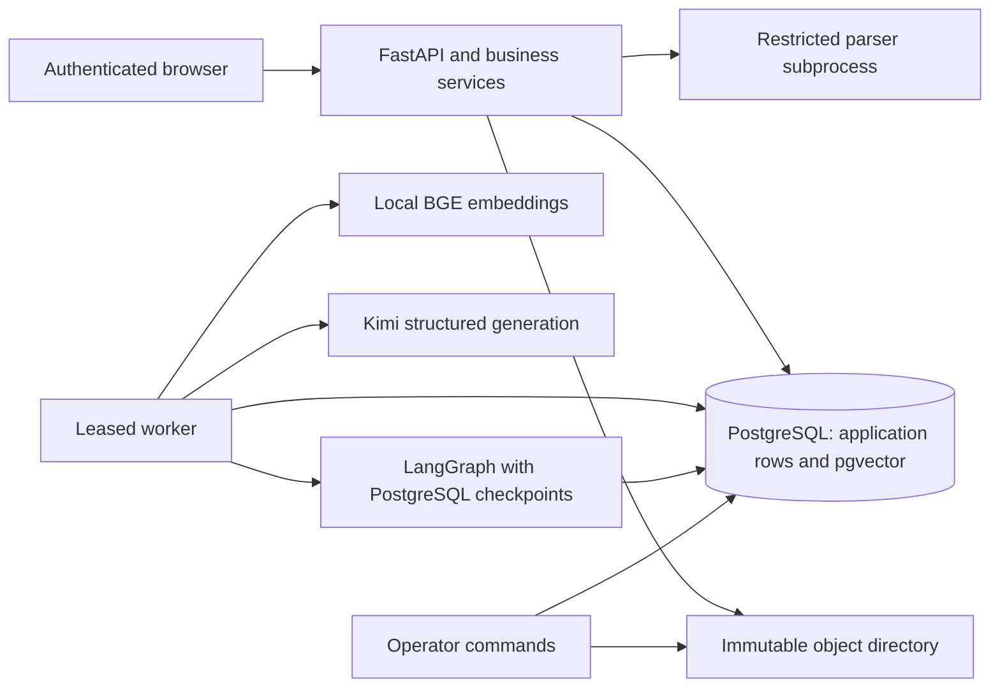
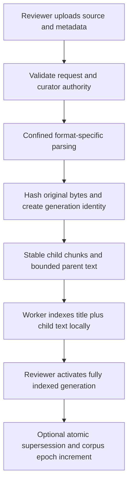
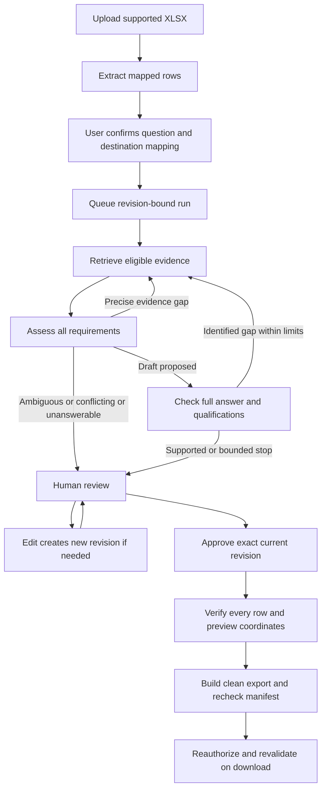

# AssureDesk: implementation manual and interview guide

**As implemented on 5 October 2026.** This manual describes the code in this directory, its measured results, and its remaining limitations. It is an explanation of the existing implementation, not a proposal to add more services.

AssureDesk is a permission-aware evidence and approval application for SaaS security questionnaires. Its agentic RAG workflow retrieves permitted evidence, identifies missing requirements, performs bounded corrective searches, checks a proposed answer, and hands the result to an authenticated reviewer. A separate deterministic approval and export policy controls what can leave the application.

The implemented product, Atlas, and customer accounts, Acme and Nova, are fictional. The current release is a **restricted local pilot**. On the fresh frozen locked comparison, corrective RAG produced **12/13 complete supported answers**, with **17/17 correct non-answerable dispositions**. These are source-grounded results on a small synthetic benchmark. A configured scheduled off-host backup remains outstanding.

Use [README.md](README.md) for short setup instructions, [the locked report](output/evaluation/kimi-k3-locked-report.md) for the measured comparison, and [the current release manifest](output/kimi-release-manifest.json) for the verification record. The original planning documents are preserved separately; this repository and manual describe what actually exists.

## Contents

1. [Project idea and business problem](#1-project-idea-and-business-problem)
2. [Scope, actors, and acceptance boundaries](#2-scope-actors-and-acceptance-boundaries)
3. [Architecture and trust boundaries](#3-architecture-and-trust-boundaries)
4. [End-to-end pipeline](#4-end-to-end-pipeline)
5. [Repository and dependency map](#5-repository-and-dependency-map)
6. [Data model and invariants](#6-data-model-and-invariants)
7. [Configuration and structured contracts](#7-configuration-and-structured-contracts)
8. [Permissions and disclosure policy](#8-permissions-and-disclosure-policy)
9. [Document parsing, workbook validation, and indexing](#9-document-parsing-workbook-validation-and-indexing)
10. [Retrieval and context construction](#10-retrieval-and-context-construction)
11. [Agentic workflow: every execution block](#11-agentic-workflow-every-execution-block)
12. [Business operations, approvals, and exports](#12-business-operations-approvals-and-exports)
13. [Worker durability and concurrency](#13-worker-durability-and-concurrency)
14. [API and browser interface](#14-api-and-browser-interface)
15. [Provider integration, costs, and limits](#15-provider-integration-costs-and-limits)
16. [Evaluation methodology and metrics](#16-evaluation-methodology-and-metrics)
17. [Actual results and failure analysis](#17-actual-results-and-failure-analysis)
18. [Tests, migrations, operations, and deployment](#18-tests-migrations-operations-and-deployment)
19. [Runbook and troubleshooting](#19-runbook-and-troubleshooting)
20. [Tutorial adaptation and engineering tradeoffs](#20-tutorial-adaptation-and-engineering-tradeoffs)
21. [Employer presentation](#21-employer-presentation)
22. [Challenging interview questions and answers](#22-challenging-interview-questions-and-answers)
23. [Code coverage index and glossary](#23-code-coverage-index-and-glossary)

Read sections 1–4 and 17 first to understand the product and its evidence. Read sections 6–15 while following the source files to understand implementation. Use sections 21–22 to practise explaining and defending the design.

### How to read the code explanations

“Code block” here means a meaningful unit of behavior: a function, class, route, graph node, validation branch, or deployment step. The manual explains those units across every application module, the frontend, migrations, tests, and CI. Short excerpts show important mechanisms. They are excerpts of the implementation, not replacement code or complete standalone programs. Source links lead to the full context. Repeating every import, closing bracket, or CSS declaration would obscure the behavior; those are grouped by their purpose.

## 1. Project idea and business problem

### 1.1 The customer problem

A SaaS vendor receives a security questionnaire before a customer buys or renews. Sales wants to answer quickly. Security must ensure the answer accurately describes the product, retains qualifications, uses current documentation, and discloses only information approved for that customer.

A typical question is: “Is all customer data, including backups, stored exclusively in the EU?” One document might establish the location of production data without establishing the location of backups. An answer that cites that document and simply says “Yes” is incomplete. A persuasive answer is not enough: the application must retrieve the second fact or explicitly leave the question for review.

There is also a permission problem. A reviewer might be allowed to read internal incident notes, yet those notes are not approved for a customer response. Nova might have a negotiated exception that Acme must not see. An administrator who manages memberships should not automatically become a content reviewer.

### 1.2 The proposed product

AssureDesk turns a supported XLSX questionnaire into a controlled review workflow:

1. Import questions and explicitly confirm their source/destination coordinates.
2. Search an authorized, current, customer-disclosable evidence corpus.
3. Decompose the question into concrete requirements and qualifications.
4. Retrieve additional evidence for identified gaps within fixed limits.
5. Check the proposed answer against the evidence and original question.
6. Present claims, citations, gaps, and history to a security reviewer.
7. Require approval of the exact current revision.
8. Build a clean workbook and revalidate eligibility on download.

This combines a permission-aware knowledge system with document intelligence and approval. The “action loop” is specific: retrieve, assess, correct, check, review, and export. The agent cannot email a customer, change an ACL, approve itself, or execute arbitrary external tools.

### 1.3 Why agentic RAG fits this problem

Ordinary one-pass RAG may retrieve the main fact but miss an exception. A corrective workflow can name the missing fact, formulate a targeted search, retain already supported evidence, and reassess the complete question. Its usefulness must be measured against a one-pass baseline; merely drawing a loop does not establish better answers.

AssureDesk measures dense, hybrid, and corrective variants under a frozen configuration. Hybrid retrieval improves discovery; correction can improve completeness. The application still needs deterministic permissions and human approval because generation and self-checking can both be wrong.

### 1.4 What successful delivery would mean

For a real customer, discovery would establish document ownership, disclosure authority, questionnaire volume, reviewer capacity, acceptable uncertainty, and integrations. Useful business outcomes would include time to a reviewed response, reviewer edits, stale-answer avoidance, and inappropriate-disclosure prevention.

Those customer outcomes have not been measured here. The implemented evidence is narrower: deterministic boundary tests, a browser workflow, restore functionality, and a frozen synthetic factual comparison. Do not claim a measured reduction in review time, closed sales, or production incidents.

## 2. Scope, actors, and acceptance boundaries

### 2.1 Deliberate scope

| Area | Implemented boundary |
|---|---|
| Product | One fictional product, `atlas` |
| Customer scope | Explicit account membership; pilot accounts `acme` and `nova` |
| Questionnaire | One visible XLSX sheet; 1–50 mapped question rows |
| Sheet bounds | At most 500 rows and 30 columns |
| Answer categories | Yes, No, Partial, Not applicable, Unknown, Declined |
| Evidence | UTF-8 Markdown, supported text PDFs, approved statement JSON |
| Generation | Kimi K3 through a small provider adapter |
| Embeddings | Local BGE small English embeddings, 384 dimensions |
| Retrieval | In-process BM25 plus exact filtered pgvector; reciprocal-rank fusion |
| Execution | One leased worker and a bounded LangGraph state machine |
| Review | Authenticated, revision-bound human attestation and claim checks |
| Export | All rows approved; clean XLSX; current manifest checked again on download |
| Storage | PostgreSQL and immutable hash-addressed local objects |

There is no OCR, arbitrary web search, enterprise SSO, live business-system connector, separate vector database, message broker, multi-agent runtime, reranker service, or Jev integration in the implemented application. Those are not necessary to explain the present system.

### 2.2 Roles

| Actor | Content access | Main operations | Approval authority |
|---|---|---|---|
| Sales | Assigned customer workbooks and sources readable by sales | Import, confirm mapping, request retrieval, edit drafts, inspect permitted evidence, export approved work | No |
| Security reviewer | Assigned customer content and explicitly readable internal material | Sales operations plus curation, review, blocking/unblocking, approval, reviewer search | Yes, within account scope |
| Administrator only | No content authority by that role alone | Change users and source role ACLs; inspect permitted operational summaries | No |

The model is not a fourth privileged user. It receives an evidence payload prepared under the original run principal. It has no independent permission context.

### 2.3 Three distinct meanings of “good”

**Model support checked:** the separate check call accepted the answer. This sets `Draft.supported`; it is a fallible model result.

**Complete supported in evaluation:** a saved source-grounded judgment says all required facts are present with no material unsupported addition. This is a benchmark judgment, not a customer approval.

**Approved for export:** an authenticated reviewer approved the current draft, its claims, evidence, scope, and fingerprint; the approval is unexpired and remains valid under current policy and corpus versions.

These states must not be conflated. One measured answer was incomplete despite a positive self-check. Some complete answers added supported but uncited facts and needed citation repair before approval.

## 3. Architecture and trust boundaries

### 3.1 Components



FastAPI serves the API and a small Jinja HTML shell. Vanilla JavaScript renders the workspace. SQLAlchemy manages application transactions; psycopg supplies PostgreSQL connections for the graph checkpointer and advisory locks. pgvector stores embeddings inside the same database. Object files contain original uploads and generated exports.

The API and worker use the same application package and container image, with different commands. Compose supplies the generation credential only to the worker. The API can support import, manual drafting, review, and download without calling a generation provider.

### 3.2 Where authority lives

| Record or component | Responsibility | Must not be treated as |
|---|---|---|
| `User`, `Source`, `Meta` | Current membership, source metadata, invalidation epochs | Model instructions |
| `Question`, `Draft`, `Approval` | Business state and exact reviewed revision | Disposable chat memory |
| `Job` | Delivery, ownership, lease, fencing generation | Evidence of completed work |
| `Stage` | Persisted node artifact and replay result | Proof a provider billed once |
| LangGraph checkpoint | Execution position and references | Approval or unrestricted content store |
| `Attempt` | Pre-call reservation and usage reconciliation | Provider invoice |
| Hash-addressed object | Immutable byte identity and integrity | Proof the document is factually true |

### 3.3 Trust boundaries

Uploads are untrusted. The parser executes in a confined child process without the application credential environment. Extracted source text and questionnaire text remain untrusted data, even after parsing.

Source metadata is entered by an authorized curator. Code uses it to decide eligibility. A curator can still misclassify a document or approve a false policy; this implementation does not prove the truth of enterprise records.

Only eligible source IDs enter either retrieval branch. Parent context is fetched through the same evidence authorization function. Model output is parsed into strict local schemas and may cite only supplied IDs. After a model call, the engine rechecks the run context before publishing its result.

Human approval is checked in application transactions. Export creation verifies a manifest before and after building the file. Download verifies the full current manifest again. These checks reduce stale publication risk; they cannot revoke a file already downloaded or recall evidence already sent to a provider.

### 3.4 Why a modular monolith

The pilot needs one transactional authority for access, budgets, drafts, jobs, and approvals. Keeping these in PostgreSQL makes the boundary inspectable and avoids distributed coordination across several stores. A separate broker or vector service would add operational and permission synchronization work without a demonstrated need at this scale.

The tradeoff is deliberate: eligible source metadata and BM25 are processed in memory, vector search is exact, and a global metadata row serializes important mutations. These are suitable for a small corpus and low concurrency. They are not a claim of large-scale throughput.

## 4. End-to-end pipeline

### 4.1 Evidence pipeline



Uploading creates an inactive source. The worker indexes it. Activation refuses an incomplete index. A rebuild creates a distinct pending generation instead of silently rewriting active chunks. Explicit supersession marks the prior source obsolete in the same transaction that activates its replacement.

### 4.2 Questionnaire and review pipeline



### 4.3 Worked example: production and backup location

Assume the permitted production document says: “Atlas production customer data is stored in the EU. This document does not establish where backups reside.” A separate customer-approved backup policy says backups are in the EU and retained for 30 days.

The import maps columns A/B/C/D to ID/question/answer/explanation and rows 2–6 to questions. The user checks those coordinates before confirming.

For the location question, the first search may provide production evidence. Assessment should identify at least production location and backup location as separate requirements. If the latter is missing, it returns `needs_evidence`, `answer: null`, and a targeted backup-location query. The engine does not convert “not established” into “No.”

Correction searches under the same customer, product, role, and date policy. Previously supported evidence can be retained, while new backup evidence is added. A proposed “Yes” needs an explanation that covers both facts. The check call receives the original question, requirements, explanation, citations, and additional supplied context to look for omitted qualifications.

The reviewer opens the excerpts, checks scope and the whole explanation, marks each mapped claim supported, supplies a rationale, and approves the current revision. Every other row must also be reviewed before a complete export is available. An explicit Unknown can be a valid reviewed response; it is never silently rewritten to No.

This example explains intended behavior and the scripted demonstration. The frozen live benchmark is separate; a deterministic browser recording does not establish model accuracy.

### 4.4 Worked failure: a missed qualification

In the locked evaluation, the corrective answer for `build-credential-2` stated that credentials expire after the job but omitted that they cannot authenticate the production administration console. The assessor modeled only one requirement, and the checker accepted the incomplete answer. No corrective search followed.

This is a useful failure diagnosis: the missing qualification was not merely a formatting problem or an API outage. It exposed a correlated blind spot between decomposition and checking. The case remains a miss in the report. Human full-answer review exists partly because this failure is possible.

## 5. Repository and dependency map

### 5.1 Application files

| File | Main intention |
|---|---|
| [app/config.py](app/config.py) | Explicit local settings and versioned run limits |
| [app/db.py](app/db.py) | ORM records, transaction wrapper, database clock, object integrity |
| [app/policy.py](app/policy.py) | Shared content, curation, disclosure, and evidence authorization |
| [app/schema.py](app/schema.py) | Strict model output and manual draft contracts |
| [app/parsing.py](app/parsing.py) | Parent-side isolated parser invocation and resource boundary |
| [app/parser_child.py](app/parser_child.py) | Confined extraction for supported formats |
| [app/workbooks.py](app/workbooks.py) | Finite XLSX profile, mapping extraction, clean export |
| [app/providers.py](app/providers.py) | Assess/check instructions, Kimi transport, local embeddings |
| [app/retrieval.py](app/retrieval.py) | Eligible BM25/dense retrieval and rank fusion |
| [app/workflow.py](app/workflow.py) | Durable bounded retrieve/assess/check/review graph |
| [app/service.py](app/service.py) | Transactional business operations independent of generation |
| [app/worker.py](app/worker.py) | Indexing, job claims, lease renewal, checkpoint execution |
| [app/web.py](app/web.py) | Authenticated HTTP routes and boundary handling |
| [app/templates/index.html](app/templates/index.html) | Accessible workspace/form/dialog shell |
| [app/templates/app.js](app/templates/app.js) | Browser interactions and review rendering |
| [app/templates/style.css](app/templates/style.css) | Layout, typography, forms, badges, dialog and responsive presentation |
| [app/operations.py](app/operations.py) | Status, deletion, retention, encrypted snapshots and restore |
| [app/cli.py](app/cli.py) | Explicit setup, model preparation, users, parser probe and inventory |
| [app/evaluation.py](app/evaluation.py) | Corpus artifacts, frozen inputs, paid variant execution and reports |
| [app/scoring.py](app/scoring.py) | Offline ranking, semantic, routing, citation and uncertainty metrics |
| `app/__init__.py` | Package marker; no additional runtime behavior |

### 5.2 Infrastructure and verification files

`pyproject.toml` declares the Python 3.12 package and the necessary runtime/dev dependencies. `uv.lock` pins the resolved environment. `alembic.ini`, `migrations/env.py`, and the migration versions define database setup. `Dockerfile` packages API/worker code once. `compose.yaml` selects their commands and persistent volumes. `.github/workflows/verify.yml` supplies deterministic CI verification without model secrets.

`tests/` contains unit, boundary, HTTP, PostgreSQL, parser, evaluation, and optional browser tests. `output/` holds verification and evaluation artifacts. `data/` contains local objects, model files, credentials, and evaluation working records and is ignored. `.env` is ignored; `.env.example` is a credential-free configuration template. No credential is reproduced in this manual.

### 5.3 Why each runtime dependency exists

| Dependency group | Actual purpose |
|---|---|
| FastAPI, Uvicorn, Jinja2, multipart | HTTP API, server process, HTML shell, uploads |
| SQLAlchemy, Alembic, psycopg | Transactions, schema migration, PostgreSQL connections |
| pgvector | Store/query 384-dimensional vectors in the application database |
| LangGraph and PostgreSQL checkpointer | Explicit routing and durable review interrupt position |
| `langchain-text-splitters` | Maintained recursive text splitter, without a whole chain stack |
| FastEmbed | Local CPU passage/query embeddings |
| `rank-bm25` | Small authorized lexical retrieval branch |
| openpyxl, defusedxml | Supported workbook handling and safer XML parsing |
| pypdf | Supported text-PDF extraction in the parser child |
| Argon2 | Password hashing/verification |
| cryptography/Fernet | Authenticated encrypted local backup archives |

Development dependencies support tests, lint, limited typing checks, HTTP test clients and optional browser automation. They do not run production retrieval. Generation uses standard-library HTTP, so a provider SDK is unnecessary for the current contract.

## 6. Data model and invariants

### 6.1 Utility and storage blocks in `db.py`

`uid()` generates UUID strings for application identities. `digest()` serializes a value with stable key ordering and hashes it with SHA-256. It binds configuration and business snapshots; it is not a digital signature.

`Base` is the ORM metadata root. `Identified` contributes the UUID primary-key field. `Database.__init__()` creates an engine with hidden SQL parameters; SQLite gets a shared in-memory pool and foreign keys for tests. `transaction()` supplies a commit-on-success, rollback-on-error session. `test_schema()` is explicitly SQLite-only; PostgreSQL must use migrations.

`db_time()` uses `clock_timestamp()` in PostgreSQL. Cross-process lease and retention decisions therefore use one database clock. The SQLite fallback uses local time for deterministic fixtures. Other application durations and some expiry/date checks use host time; the design is not wholly independent of host clock correctness.

`Objects.put()` names a file by the SHA-256 of its bytes, creates it exclusively, and applies owner-only file permissions. If the file already exists, byte equality is checked. `Objects.get()` accepts only a lowercase hexadecimal 64-character identifier and verifies the loaded bytes against that identifier. This prevents object-path traversal and detects corruption. File creation and the database commit are not one atomic transaction; an unreferenced object can remain after a rejected operation and later be collected.

### 6.2 ORM record blocks

| Record | Important fields and intention |
|---|---|
| `Meta` | Singleton `policy` and `corpus` epochs; global invalidation and a serialization lock |
| `User` | Name, Argon2 password hash, roles, accounts, active flag; current access principal |
| `Login` | Hash of random bearer cookie, CSRF token, user, expiry; raw session token is not stored |
| `Source` | Family/title/product/account/roles/disclosure/audience/dates/authority; immutable object hash, active/superseded status, provenance, pipeline and generation identity |
| `Chunk` | Source ID, child text, locator/start, parent text, vector/model and preprocessing/span metadata |
| `Workbook` | Customer, product, as-of date, original object hash, mapping, confirmation and creation time |
| `Question` | Workbook row, external key, text, revision, current draft pointer and blocked flag |
| `QuestionVersion` | Immutable captured question text for a revision, actor and time |
| `Draft` | Question/revision, enum/explanation, evidence, author, model support flag, epochs and claim mappings |
| `Approval` | Exact draft, reviewer, fingerprint, expiry and explicit support-review record |
| `Run` | Original principal, question revision, epochs, retrieval mode, state/counters/timing/stop reason and protected trace |
| `Job` | Run delivery identity, state, owner, fencing generation, lease, delivery attempts, cancel/resume flags |
| `Attempt` | Run/workbook identifiers, type, maximum reserved estimate, reported estimate if known, status and safe usage details |
| `Export` | Workbook, approval-manifest fingerprint and generated object hash |
| `Event` | Actor/action/target/time/details; application audit history |
| `Stage` | Stable run/step/node key, node inputs and completed routing output; replay ledger |
| `OperationalState` | Worker heartbeat and bounded operational error classifications |
| `RequestKey` | User/operation/key identity, request payload hash, stored result; request idempotency |

`Attempt.run_id` and `workbook_id` are deliberately strings rather than foreign keys: accounting survives removal of business content. Evaluation campaign/batch identifiers in attempt details preserve budget reconciliation even when related runs no longer exist.

### 6.3 Constraints and identities

The database enforces one question per workbook row, one draft per question/revision, one approval per draft, one export per workbook/manifest, unique job deliveries, and unique nonlegacy source generations. Question versions are unique per question/revision. These constraints back up application logic under concurrency.

A source generation hashes original bytes, curated metadata, parser/chunker versions, and rebuild ancestry. Chunks use deterministic UUID5 identities from the generation, locator, and start offset. A changed generation therefore cannot masquerade as an old citation just because its words look similar.

An embedding also records the embedding model and artifact fingerprint. Matching model names alone are insufficient for reliable cache reuse when local model artifacts change.

### 6.4 Revision, epoch, and fingerprint are different

**Revision:** protects a particular question/draft from stale edits. The client supplies `expected_revision`; a mismatched request is rejected. Creating a new draft increments the question revision.

**Epoch:** detects policy or corpus changes affecting runs and approvals. `Meta` is global, so an unrelated source activation can invalidate existing drafts and approvals. That is conservative and simple, but can cause extra review work.

**Fingerprint:** binds exact question text/revision, draft content, claim mappings, evidence identities and disclosure metadata, workbook scope, and epochs. Approval is valid only while this fingerprint remains current.

```python
policy.require(draft.id == q.current_draft and draft.revision == q.revision, "stale_draft", 409)
policy.require((draft.policy, draft.corpus) == (meta.policy, meta.corpus), "source_or_policy_changed", 409)
```

These checks in `service.fingerprint()` prevent an old approval from being reused after a new draft or source/policy change. Merely retaining an approval row does not retain its authority.

## 7. Configuration and structured contracts

### 7.1 `config.py` blocks

`load_local_env()` reads only the explicitly named local `.env`; it does not search sibling projects. Environment values already supplied by a process win through `setdefault`. `Settings.env()` converts the environment into a dataclass. Database URL and provider key are excluded from the dataclass representation, reducing accidental disclosure.

Settings define the model, object and embedding directories, conservative token prices, and cookie security. `LOCAL_HTTP=1` disables the Secure cookie requirement for loopback development. Private deployment needs HTTPS and secure cookies.

`LIMITS` contains the versioned policy: three rounds, five embeddings, seven generation attempts, 90 active seconds, a 6,000-byte input allowance, 1,200 completion tokens, $0.15/run, $5/workbook/day, $15/batch, $30/campaign, and 90-day default retention. The workflow/provider implement several matching caps as literals; changing the dictionary alone is not a safe migration of those policies. Freeze hashing detects code changes, but settings and enforcement need review together.

Native API startup requires care: `Settings.env()` can read the local secret file even though the API never calls the provider. Run the native API with `MOONSHOT_API_KEY=''` to keep its settings credential-free. Compose achieves that separation by loading `.env` only into the worker container, where the ignored file itself is not copied into the image.

### 7.2 `schema.py` blocks

`Strict` sets `extra='forbid'`. Unknown model fields are rejected rather than silently accepted. `Answer` and `ANSWERS` define the six answer categories shared with workbook validation and the UI.

`Requirement` holds a concrete claim, coverage status, and evidence IDs. It limits claim length and reference count. It cannot prove that decomposition included every relevant requirement.

`Proposal` limits requirements to 1–12 and correction queries to at most two. `consistent()` checks nonempty bounded query strings and ties answer presence to status:

```python
if self.status == "draft_proposed":
    if self.answer is None or any(r.coverage != "supported" or not r.evidence_ids for r in self.requirements):
        raise ValueError("Incomplete draft")
elif self.answer is not None:
    raise ValueError("Non-draft answer")
```

The intention is structural consistency: a model cannot return `needs_evidence` with an apparently final “Yes,” or a draft with a self-declared missing requirement. A schema-valid draft can still contain an omission or false assertion; semantic evaluation and review are separate.

`Support` returns a support boolean, up to twelve missing items and two next queries. It does not perform the same per-query string validator as `Proposal`; provider input and embedding caps still bound later work. `DraftInput` validates manual draft requests and their expected revision. The service validates the internal claim-to-evidence mappings, because those are dictionaries rather than fully typed per-claim Pydantic objects.

## 8. Permissions and disclosure policy

### 8.1 Authorization blocks in `policy.py`

| Block | Intention and behavior |
|---|---|
| `Rejected`, `require()` | Typed content-safe rejection with stable code and HTTP status; many access failures deliberately use 404 |
| `content_user()` | Require active user, account membership and sales/reviewer role |
| `access()` | Require content authority for a workbook and the fixed Atlas product |
| `security()` | Require reviewer role, plus workbook access when provided |
| `curate_source()` | Restrict creation/change authority to the source's customer scope; global public/internal sources require both pilot accounts |
| `admin()` | Require administrator role for membership/ACL administration |
| `readable()` | Match user/customer/product and at least one allowed source role |
| `eligible()` | Add activation, nonsupersession, dates, authority and disclosure policy |
| `epoch()` | Load the singleton versions, optionally `FOR UPDATE` |
| `evidence()` | Deduplicate IDs, load each chunk/source, and reapply eligibility |
| `draft_access()` | Permit inspecting a draft only if its cited sources are currently readable; export uses stricter current eligibility |

### 8.2 Reading is not disclosure

The critical branch is:

```python
not disclose or (
    source.authority != "historical_response"
    and (
        source.disclosure == "public"
        or (source.disclosure == "customer_approved" and workbook.account in source.audience)
    )
)
```

Generation, manual answer evidence selection, approval and export normally use `disclose=True`. Authorized reviewer search and evidence inspection can use `disclose=False`. That allows readable internal context to assist human investigation without feeding it into a customer answer.

A historical response is not current authority just because a similar questionnaire was answered before. It may be inspectable but cannot support a current customer claim through the disclosure path.

### 8.3 Date policy

A source must cover the workbook's as-of date and must not have expired by the current date. It must also be active and not superseded. The code checks `valid_from <= as_of <= valid_until` and `today <= valid_until`. It does not separately test `today >= valid_from`; normal imports reject future as-of dates, which already constrains this case.

Dates are ISO strings after validation, permitting chronological comparison for this finite format. They do not model arbitrary time zones, effective hours, or a full policy version graph.

### 8.4 Every search stays within the same scope

The model supplies only search strings. It cannot replace the principal, product, account, disclosure flag, or as-of date. A rewritten query mentioning Nova does not grant an Acme run Nova access.

The engine repeats policy checks before provider admission, after waiting, before reservation/dispatch, after the response, during parent access, at draft publication, at approval, during export creation and on download. A change before publication fences the result. It cannot unsend an already dispatched HTTP payload.

### 8.5 Security claims and residual limits

The mandatory tests cover customer isolation, role revocation, internal-only exclusion, invented citations, prompt-injection fixtures and stale exports. In the locked Acme regional-agreement traces, zero Nova-only chunks were observed across twelve relevant candidate/context traces.

That is concrete test evidence, not a proof of universal noninterference. PostgreSQL row-level security is not implemented; application code owns the boundary. Audit rows are not a tamper-evident external ledger. A database administrator or compromised application process remains a powerful threat. Prompt instructions improve behavior but do not establish immunity to prompt injection.

## 9. Document parsing, workbook validation, and indexing

### 9.1 Parent-side parser boundary: `parsing.py`

`parse_source()` validates suffix and the 10 MB source upload cap, writes a read-only input into a temporary directory, and invokes `parser_child.py` with Python isolation. An optional mapping JSON file accompanies XLSX input. The child receives only a small runtime environment; it does not inherit provider keys.

macOS uses `sandbox-exec` with an explicit profile allowing runtime/code/input reads and writes only to the output area. Linux requires the child-installed filesystem and syscall confinement. Unsupported hosts fail closed. Child stdout/stderr are discarded so parser errors cannot echo restricted content into logs.

The parent enforces a 15-second wall timeout, output size limits, and the expected parsed JSON shape. Empty extraction or malformed output is rejected. A process exit is not treated as successful extraction.

### 9.2 Child confinement: `parser_child.py`

The top-level resource block sets ten seconds of CPU time and an 8 MB file-output ceiling. Linux also sets a 1 GB address-space ceiling. macOS instead runs an RSS watchdog that exits above 512 MB; that is a watchdog, not an equivalent hard address-space limit.

The Linux branch verifies the supported architecture and Landlock ABI ≥3, creates a ruleset, adds read access to runtime/code/input paths and write access to the output directory, then applies `no_new_privs` and Landlock. Missing confinement raises an error.

The seccomp block denies sockets/connections, io_uring setup, process execution/creation, process memory inspection, ptrace and signals to other processes. It prevents the parser from using network or spawning helpers. Runtime library roots must still be readable; the child is not allowed to read arbitrary application data or the ignored secret file.

### 9.3 Format extraction branches

| Branch | Behavior and intention |
|---|---|
| XLSX | Import `workbooks.extract()` inside the restricted child and return mapped question rows |
| PDF | Check PDF signature; reject encryption and >200 pages; extract layout text; reject replacement glyphs and likely table/column layouts; bound each page; preserve page locator |
| Markdown | Split paragraph sections, track heading ancestry and original character offsets; preserve section text and bounded locator |
| Statement JSON | Require exactly `{"statement": <string>}`; return one explicitly scoped statement block |
| Final extraction check | Require nonempty blocks and ≤2,000,000 extracted text characters |

There is no OCR. An image-only PDF has no usable extracted text and fails. The layout heuristic is intentionally conservative and can reject a legitimate PDF with large internal spacing; the remedy is curated supported text, not guessing table order.

### 9.4 Workbook package validation: `workbooks.py`

`ALLOWED_PARTS` is a finite set of workbook ZIP members. `validate_package()` accepts at most 5 MB compressed input, ≤200 unique entries, ≤25 MB declared expanded bytes, and a ≤100:1 expansion ratio for each entry. It rejects encrypted ZIP members, traversal-like paths, unrecognized parts, formulas, hyperlinks, OLE/external references, external relationships and macro content. XML is parsed with defusedxml.

`load_safe()` then verifies one visible worksheet, row/column bounds, no hidden rows or columns, no cell formulas/links/comments, only supported scalar cell values, and bounded cell text. If list validation is present, its choices must represent the complete answer enum, including uncertainty. A binary-only Yes/No template is unsuitable for this workflow.

`extract()` validates the mapping has exactly six integer keys: four distinct columns and first/last question rows. It rejects overlapping columns, too many questions, merged cells intersecting question rows, empty IDs/questions, duplicate IDs and overlong external IDs. It returns the original row coordinate with each question.

### 9.5 Clean export instead of copying ZIP parts

`clean_export()` reloads the supported original, creates a fresh workbook, copies allowed visible values and basic styles, clears the mapped response area, inserts approved answer/explanation text, and inserts current edited question text. Values are written as strings:

```python
cell.value, cell.data_type = text, "s"
```

A response beginning with `=` is therefore text, not a formula. The function checks answer count and enums, saves with AssureDesk creator metadata, and validates the generated package again. It does not promise arbitrary Excel fidelity, formulas, external links, embedded objects or full preservation of all workbook features.

`sample_workbook()` creates the supported five-question synthetic template with six answer choices. It is fixture/setup content, not a general XLSX conversion engine.

### 9.6 Source generation and chunking: `service.add_source()`

The metadata block validates required keys, account/role/audience/disclosure/authority values, dates, title/family bounds, curator scope, and provenance for approved statements. The source begins inactive.

The pipeline block records parser version, format, chunker identifier, uploader, acquisition time and rebuild ancestry. The generation hash makes identical ingestion content/configuration idempotent.

The chunker uses the maintained recursive splitter:

```python
RecursiveCharacterTextSplitter(
    chunk_size=1000, chunk_overlap=150, add_start_index=True, strip_whitespace=False
)
```

These sizes are characters, not tokens. Each extracted block is split independently. Every child retains its original start/end and text hash. Parent text adds up to 200 surrounding characters on each side within that block. This recovers nearby qualifications without fetching an unbounded whole document.

The metadata records dimensions and preprocessing. The actual indexing stage records its final `title-child-v2` preprocessing and embedding artifact revision. Activation requires every chunk to have a vector.

### 9.7 Indexing: `worker.index_pending()`

The worker selects up to twenty never-indexed chunks, constructs title-plus-child input, and searches for an existing vector with the same index text hash, embedding model and artifact revision. A cache hit reuses the vector; otherwise local passage embedding runs.

An oversized embedding input is marked `rejected:embedding_input_limit`; it is not endlessly selected as unprocessed input. Its vector remains missing, so source activation fails. Another ingestion error is recorded without preventing previously indexed question jobs from running.

The cache avoids unnecessary CPU work. It is not a provider-response cache and does not store model answers for reuse across customers.

## 10. Retrieval and context construction

### 10.1 `retrieval.words()`

The lexical tokenizer lowercases text and extracts alphanumeric tokens with a regular expression. It is simple and inspectable. It does not stem, expand synonyms, or provide multilingual segmentation.

### 10.2 `retrieve()`: eligible pool first

The first block loads source metadata and resolves eligibility before loading chunk text or computing either branch's scores:

```python
sources = {src.id: src for src in session.scalars(select(Source)) if policy.eligible(user, src, book)}
```

Only chunks from these source IDs enter BM25. PostgreSQL dense search also includes those IDs in SQL. This avoids relying on a prompt or filtering an unrestricted top-k result after retrieval.

The metadata scan itself is global within the application process. It is not row-level isolation of the database or a scalable tenant index.

### 10.3 BM25 branch

BM25 is constructed from source title plus child text in the eligible pool. For each query, the branch orders scores deterministically by score and chunk ID and considers twelve results. Only positive lexical scores contribute to fusion.

Titles help identify controls whose child text may not repeat the question's label. BM25 scores depend on the authorized corpus; the system does not interpret them as probabilities.

### 10.4 Dense branch

PostgreSQL orders eligible, non-null vectors with the matching embedding model by cosine distance and stable chunk ID, returning twelve candidates. No approximate vector index is configured. SQLite implements cosine sorting only for tests.

For vectors `a` and `b`, cosine similarity is their dot product divided by the product of their lengths. Cosine distance decreases as similarity increases. Dense retrieval can match paraphrases but can confuse neighboring control topics; lexical retrieval helps with exact terms and document titles.

### 10.5 Reciprocal-rank fusion

Each branch/query result contributes:

```python
scores[chunk.id] += 1 / (60 + rank)
```

The fused score is the sum of those contributions. Ranked IDs are deduplicated through the score dictionary, with twenty final candidates. Rank fusion avoids assuming BM25 and cosine scores share a calibrated scale. The constant 60 is fixed; it is not demonstrated to be globally optimal.

In dense mode only the dense branch contributes. Hybrid mode uses both branches for one retrieval round. Corrective mode uses the same hybrid mechanism and can run additional gap queries. The baseline comparison is therefore about retrieval combination and correction, not three unrelated stacks.

### 10.6 Candidate ranking is not the model context

`Engine.payload()` reauthorizes all candidates before selecting at most six excerpts. It limits each source to two chunks, rejects overlapping child spans from the same source/locator, expands accepted children into bounded parent text, and checks the full prompt/schema byte bound before adding each excerpt.

Each evidence item contains an ID, title, topic, locator, valid-from date and original parent text. Selection leaves headroom at 5,900 bytes for a possible format-repair instruction within the 6,000-byte ceiling. Oversized entries can be skipped; high candidate recall therefore does not guarantee the model received every required span.

The check call prioritizes cited evidence and includes additional supplied context when it fits. It may remove only uncited extras to meet its bound. It never silently drops cited evidence just to make the request fit.

### 10.7 Corrective evidence retention

The next search preserves up to three unique IDs from requirements previously marked supported before adding newly retrieved candidates. IDs are authorized again during context construction. This helps avoid answering the second fact while forgetting the first.

These retained anchors mean the final corrective candidate list is not simply the latest raw RRF top-k. Its metrics describe the final workflow candidate list including retention. The six-excerpt/source-diversity/byte limits still apply.

### 10.8 What retrieval does not prove

A relevant chunk does not guarantee the complete required source span was supplied, that the model used it, that the answer retained its caveat, or that a citation entails the answer. AssureDesk records first/final candidates and first/final supplied context separately, then evaluates complete spans and actual answers.

## 11. Agentic workflow: every execution block

The central implementation is [workflow.py](app/workflow.py). It is a bounded state machine, not an open-ended autonomous agent.

### 11.1 State and engine construction

`State` contains `run_id`, routing code, and graph step. The protected application database holds the question, evidence, draft, counters and trace. `Engine.__init__()` injects database, generator and embedding dependencies; tests can supply deterministic generators without changing the workflow. An optional job guard binds execution to a particular delivery owner and fencing generation.

`stage_key()` combines run, step and node. `finish()` creates or updates that stage's completed routing artifact and increments the step. A completed stage can be replayed without recreating its business artifact.

### 11.2 `context()`: the common execution guard

This function loads epochs, run, original principal, question and workbook. When supplied, the job guard checks owner, generation, cancellation, running state and unexpired database-clock lease. It rejects cancelled runs, inaccessible workbooks, changed question revisions, changed epochs and blocked questions.

It also checks accumulated active work against 90 seconds. `terminal=True` permits finalization/review after a time limit; it does not waive permissions, revisions or lease checks. This prevents a timeout from bypassing security while allowing a bounded stop to be recorded.

### 11.3 `reserve()` and `reconcile()`

`reserve()` takes the singleton metadata row lock, revalidates context, increments the appropriate persisted attempt counter, and checks accumulated `coalesce(actual, reserved)` charges. Local query embeddings reserve zero dollars but consume a bounded attempt. Generation reserves the conservative maximum call estimate. A format repair consumes both a generation attempt and the one shared repair allowance.

The function checks run, workbook, UTC day, and optional evaluation batch/campaign caps. It persists the attempt before any external generation request. The global lock serializes competing reservations so two workers cannot both read the same remaining budget and overspend it.

`reconcile()` records reported estimated cost if known, marks that attempt complete, and adds completion time and token counts. If usage is unknown, the reservation remains charged. A transport exception does not imply a free call.

### 11.4 `call()`: admission, transport, validation, repair

The first block bounds the complete messages/schema input. It validates context before provider admission, waits outside a database transaction, then validates again and records waiting separately from active work. Moving `active_started` forward by the wait prevents the pacing delay from consuming the active-work allowance.

The reservation block revalidates and commits budget before `generator.invoke()`. Typed failures add safe error classifications to the attempt without recording the raw response body. Successful transport is reconciled even when the model content fails local schema validation.

The publication block rechecks context after the response and records usage. If parsed output is absent, exactly one shared concise schema-repair call is available within the existing counters, context and spending caps. It preserves the evidence payload. A failed repair routes to review; transport failures are not silently retried.

### 11.5 `search()`: bounded evidence discovery

The preparation block reuses saved stage input after restart. Otherwise it permits one round for dense/hybrid and three for corrective, takes the original question on the first round and at most two gap queries later, and removes previously used exact query strings. Repeating the same queries stops with `no_progress`.

Each query consumes one persisted embedding attempt. Retrieval runs under the current principal and scope. The result block retains up to three previously supported anchors, records up to twenty candidate IDs, round/query counts, new IDs and seen evidence, and routes to assessment when candidates exist. No candidates route directly to review.

### 11.6 `payload()` and `assess()`

`payload()` constructs the authorized bounded context described in section 10. Later rounds include precise prior missing requirements. It returns both the request payload and the exact supplied ID list.

`assess()` records supplied IDs, calls the structured assessor, and rejects any evidence reference outside that list. It saves the proposal and per-round trace. Progress means newly supplied evidence or a new concrete supported-requirement string. This is a practical stop heuristic; it is not a mathematical proof of increased coverage, and paraphrasing a claim can appear new.

`draft_proposed` routes to checking. A precise evidence gap with next queries can route back to search. Later rounds without progress, ambiguity, conflict or exhausted support route to review. The same constraints apply even if the model asks for more work.

### 11.7 `check()`: a separate fallible grounding call

The preparation block reparses the saved proposal, gathers claim citations, reauthorizes cited and additionally supplied evidence, and constructs a checker payload containing the original question, recipient, product, requirements, explanation and original parent text. If needed, only additional uncited context is removed to meet the input ceiling.

If the checker returns supported with no missing requirements, the publication transaction creates a new draft, records claim mappings and updates the run revision to the new question revision. Draft creation and stage completion occur together. The result is still unapproved.

Otherwise the engine records precise missing facts and correction queries and either searches again or routes to review. The checker is a separate invocation of the same model/provider family. Agreement between calls does not guarantee factual completeness.

### 11.8 `review()`: interrupt with business authority outside the graph

If no draft exists, this node creates an explicit Unknown with an explanation that a complete supported answer was not established. It records active elapsed time, marks the run `awaiting_review`, and interrupts with run/draft IDs.

```python
interrupt({"run_id": ident, "draft_id": draft_id})
```

On resume, the node reauthorizes the original principal, checks a real unexpired `Approval` row, and compares its fingerprint against current business state. Only then does the run become succeeded. A graph resume command alone cannot approve anything. Even Unknown needs an authenticated review decision before export.

### 11.9 `bounded()` and `graph()`

`bounded()` rechecks context before returning a cached stage output. For recognized resource, schema, provider and evidence errors, it records the stop reason and routes to review. Authorization, stale-run and lease errors propagate instead of being converted into a publishable result. Provider daily-limit classification also propagates to worker handling so dispatch stops.

`graph()` creates search, assess, check and review nodes and conditional edges driven by the routing code. It starts at search and ends after review. PostgreSQL checkpointing supplies durable execution position; the worker also sets a recursion limit of 24. The graph's edges are intentionally explicit and small enough to inspect.

## 12. Business operations, approvals, and exports

[service.py](app/service.py) owns business behavior independently of the LLM adapter.

| Function/block | Intention and main boundary |
|---|---|
| `audit()` | Add actor/action/target/details to application history |
| `remember_question()` | Capture a question revision once; retain original and edited text |
| `once()` | Scope an idempotency key to user and operation; compare payload hashes; return saved result or reject reuse with different content |
| `import_workbook()` | Check account/date, save original object, create unconfirmed workbook and immutable initial question versions |
| `question_context()` | Resolve question/workbook and enforce content access |
| `confirm_mapping()` | Explicitly mark reviewed coordinates confirmed and audit the decision |
| `add_source()` | Validate curator metadata, generation identity and chunk provenance; create inactive evidence |
| `activate_source()` | Refuse missing vectors; validate supersession family/product/account; activate and supersede atomically; increment corpus epoch |
| `change_user()` | Administrator-only membership change with valid pilot roles/accounts; increment policy epoch |
| `start_run()` | Require confirmed mapping, expected revision, permitted mode and unblocked question; create run and unique start delivery with configuration digest |
| `new_draft()` | Reauthorize citations, validate enum/explanation/claims, increment revision and save a new immutable draft |
| `fingerprint()` | Bind exact current content, scope, citations and epochs; refuse stale or blocked state |
| `approve()` | Reviewer-only revision-bound support attestation, claim checks and rationale; persist expiring approval; queue matching graph resumes |
| `block_question()` | Change review disposition and revision; only reviewer may unblock |
| `export_manifest()` | Check all current drafts, evidence, fingerprints and unexpired approvals; return full workbook approval manifest and rows |
| `build_export()` | Validate manifest, build file outside transaction, validate again, reject changed snapshot, deduplicate export by fingerprint |
| `download()` | Reauthorize and compare current full manifest before reading the generated object |

### 12.1 Idempotency is scoped and payload-bound

`once()` stores `user:operation:key` plus a payload digest. A retry with the same identity/content returns the original result. Reusing the key with different content returns 409. The global lock avoids racing duplicate application operations.

The browser currently generates a new UUID per mutation. It does not implement an automatic network retry that preserves a request key. A client that retries a request should retain its original key. Export creation is separately content-idempotent through its manifest fingerprint.

### 12.2 Manual edits

A substantive draft requires eligible citations. Unknown and Declined may have no evidence, but still require an explanation and later review. If no explicit claim mapping is supplied, the service maps the full explanation to the selected evidence. Explicit claim entries must be nonempty and refer only to the draft's evidence list.

A manual edit cannot inherit the old approval. Its new revision, wording and evidence change the fingerprint. The model support flag defaults false for manual drafts and is not necessary to approve a carefully reviewed manual answer.

### 12.3 Approval semantics

The reviewer must attest support. Substantive answers require evidence on every mapped claim. All provided claim-review booleans must be exactly true and their count must match the claim list. A bounded nonempty reason is saved with the claims hash, revision and review time.

When the API omits `claim_reviews`, the service defaults them to true after the overall explicit attestation. The browser is stricter: it requires every visible claim checkbox, full-answer attestation and rationale before enabling approval. This pilot does not prove that a human actually read each excerpt just because the record says they attested.

Approval expiry is at most seven days and no later than the end of the cited source's expiry date. A previously saved approval is reused only if its fingerprint is still identical and it remains unexpired.

### 12.4 Export consistency

File construction can take place outside the lock. To prevent that interval from publishing stale content, `build_export()` records the manifest before construction and recomputes it before saving the export row. A mismatch is `export_stale`.

Download recomputes the complete manifest even for an old URL. Source deactivation, membership changes, edited text, blocked questions or expired approvals can therefore block an already-created export. The file itself is immutable; its download authority is current.

## 13. Worker durability and concurrency

[worker.py](app/worker.py) deliberately distinguishes job delivery from stage completion and provider billing.

### 13.1 Claiming and lease renewal

`claim()` selects an uncancelled queued job or expired running lease with fewer than three delivery attempts. PostgreSQL `FOR UPDATE SKIP LOCKED` prevents concurrent workers from claiming the same available row. Claiming assigns owner, increments generation, sets running state, and grants a 120-second database-clock lease.

`heartbeat()` renews every twenty seconds only while owner/generation/status/lease remain valid. It stops after cancellation, lost ownership or expiry. A new owner gets a new generation; the old owner is fenced from application commits by engine guards.

### 13.2 Checkpoint and advisory-lock blocks

`psycopg_url()` converts the SQLAlchemy URL for psycopg without printing it. `saver_locked()` hashes the run ID to a PostgreSQL advisory-lock key and refuses concurrent checkpoint execution for the same run. It supplies `PostgresSaver` and always releases the lock. If the run was deleted during execution, the final cleanup removes any checkpoint reference written after deletion.

The lease grants delivery authority; the advisory lock protects one graph thread's checkpoint writes. The completed `Stage` artifact protects business-node replay. They solve different concurrency problems.

### 13.3 `execute()` lifecycle

The worker starts lease renewal, loads delivery/resume state, acquires the advisory lock, checks the job guard, starts active timing and marks the run running. It reconstructs the graph and reads the checkpoint. A new run starts from its ID; an existing checkpoint continues; an approved interrupted run receives `Command(resume=True)`.

The return path marks the job paused when a graph interrupt is present, otherwise succeeded. Typed failure reasons are retained; arbitrary exceptions become a safe `execution_failed` classification. Finalization updates only a still-owned unexpired delivery and records elapsed time. It logs IDs/status/reason, not provider payloads or evidence.

### 13.4 Crash semantics

If a completed stage artifact exists but the checkpoint position was not saved, replay returns that artifact. If a provider request may have completed but its artifact was not committed, a later execution can need another request. The earlier unknown reservation stays charged, and any new attempt consumes the same limits.

This is **not exactly-once provider billing**. A database transaction cannot atomically commit with a remote model request. The implementation limits duplicate consequences and preserves uncertainty instead of pretending that ambiguity disappeared.

### 13.5 Worker main loop

`main()` constructs the provider and local embeddings once, writes the worker heartbeat, indexes pending chunks, claims a question job, and executes it. Safe ingestion errors are recorded separately so they do not starve existing indexed question work. `--once` allows one operator-controlled pass.

After a provider daily/TPD limit the worker exits. Restart only after the allowance resets. The process-local dispatch pacing is valid for the intended single worker; launching several workers would require coordinated provider admission, even though PostgreSQL reservations already serialize cost.

## 14. API and browser interface

### 14.1 `web.py` application boundary blocks

`hash_token()` hashes the bearer session cookie. `create_app()` builds injectable database/object/settings dependencies, template support and the FastAPI routes. Tests use the same application factory with disposable fixtures.

The rejection handlers return stable error codes and status values. Malformed JSON/types/keys produce `invalid_request`, rather than echoing request content. The middleware checks mutation origin, bounds both declared and streamed request bodies to 11 MB, and returns no-store, nosniff, same-origin CSP, no-referrer and frame denial headers.

`principal()` checks an unexpired session hash and active user on every authenticated operation. Mutations also require the session's CSRF token using constant-time comparison. Content permissions are checked separately by the route/service. Authentication alone is insufficient.

Login verifies Argon2 passwords, rate-limits attempts by client address in one process, creates a random eight-hour cookie and CSRF value, and sets HttpOnly/SameSite plus configurable Secure attributes. Logout removes the session. This is local account authentication, not enterprise identity federation; the in-memory limiter is not a multi-instance anti-abuse service.

### 14.2 Route blocks by user journey

| Route group | Implementation intention |
|---|---|
| `/health/live`, `/health/ready` | Process liveness; database/epoch/migration-003 readiness. Readiness does not imply model quality or worker health |
| `/`, `/app.js`, `/style.css` | Serve local HTML/JS/CSS without a frontend build chain |
| `/v1/login`, `/logout`, `/me` | Session lifecycle and current identity/CSRF |
| `/v1/template`, `/questionnaires` | Supported sample template and account-filtered workbook list |
| `/questionnaires/import`, `/{id}/mapping` | Confined extraction, account recheck, idempotent import, explicit mapping confirmation |
| `/questionnaires/{id}` | Authorized current rows, cell coordinates, readable drafts, current approval flags and original-principal run trace |
| `/questions/{id}/runs`, `/runs/{id}` | Idempotent revision-bound request and principal-bound status hydration |
| `PATCH /questions/{id}` | Bounded text edit with expected revision and preserved question history |
| `/questions/{id}/drafts`, `/decisions` | Manual draft validation and idempotent approval/block/unblock/change requests |
| `/questionnaires/{id}/preview`, `/exports` | Full current approval checks and exact destination-cell preview; clean export creation |
| `/exports/{id}/download` | Current manifest/permissions before file delivery |
| `/evidence/{id}`, `/sources/{id}/chunks` | Authorized original excerpt/parent inspection; source chunk inspection can show readable pending content |
| `/sources`, `/sources/import` | Role/customer-readable source inventory and reviewer curation |
| `/sources/{id}/reindex`, `/activate`, `/deactivate` | Pending rebuild, complete-index activation/supersession and revocation |
| `/sources/{id}/acl`, `/users/{id}/permissions` | Administrator-controlled ACL/membership mutations with policy invalidation |
| `/jobs/{id}/cancel` | Original-principal cancellation, delivery fencing and withdrawal of a current run-generated draft |
| `/questions/{id}/evidence-options` | Only customer-disclosable current evidence for manual selection |
| `/questions/{id}/history` | Readable revision/claim history; reviewer decision reasons restricted for other roles |
| `/search` | Reviewer-only lexical inspection that may include readable internal sources, outside customer generation |
| `/operations`, `DELETE /sources/{id}` | Restricted operational summaries and explicit source purge |

Reindex now stores the predecessor **source ID** used by activation. Source inventory also translates legacy predecessor generation hashes into IDs, preserving the old pending-rebuild handoff. The questionnaire route selects the newest run using its `run_requested` event timestamp, rather than random UUID order.

### 14.3 Frontend code blocks in `app.js`

| Function or event block | Purpose |
|---|---|
| `$`, shared `me/book/running/answers` | DOM lookup and small current-page state |
| `node()` | Create elements and assign untrusted text through `textContent`, avoiding HTML injection through rendering |
| `message()` | Status/errors in the live message region |
| `api()` | Relative fetch, CSRF header, mutation request ID, JSON/FormData handling and safe error display |
| `action()` | Button wrapper with disabled-in-flight state, error handling and reenable |
| `books()`, `session()` | Load current identity/accounts and permitted workbooks; show role-appropriate forms |
| `evidence()`, `load()` | Open original parent context or load selected workbook |
| `render()` mapping block | Show extracted coordinates and require confirmation |
| `render()` export block | Disable preview until every row is approved/unblocked; show exact export cells and download link |
| `render()` question/history block | Show text, current revision, claim mappings, citations, coverage and correction traces |
| `render()` manual-edit block | Select one of six answers, choose permitted evidence and create a new revision |
| `render()` approval block | Require per-claim checkboxes, overall attestation and review rationale |
| Login/logout/import/source-upload handlers | Submit finite forms, refresh session/workbook/source lists and display outcomes |
| Source-list handler | Inspect readable chunks, rebuild, activate with predecessor ID, deactivate and show generation/expiry |
| Three-second polling block | Poll only browser-tracked runs, refresh terminal states, stop tracking on error |
| Reviewer-search and operations handlers | Show permitted evidence search and safe operational status in the dialog |
| `workbookForm()` | Convert four columns and two row values into explicit numeric mapping JSON |
| `sourceForm()` | Assemble finite source metadata, role/audience lists and provenance |

The frontend hides some unavailable actions for usability. Server authorization remains mandatory regardless of button visibility. Browser refresh loses its in-memory polling map; it can still reload saved drafts/state. Some administration/cancellation/deletion actions are API/operator capabilities rather than dedicated UI panels.

`index.html` provides labeled forms, semantic sections, a modal evidence dialog, external same-origin scripts/styles and an aria-live status region. CSS provides the visual layout and responsive presentation; it contains no business authorization or model logic.

## 15. Provider integration, costs, and limits

### 15.1 Prompt blocks

`ASSESS` instructs the model to use only supplied evidence, decompose all subquestions and exceptions, preserve qualifications, distinguish missing evidence from No, return clarification for unspecified settings, and identify actual contradictions rather than vote across sources. It forbids invented universal/exclusive claims and disclosure approval.

`CHECK` tests full-answer entailment, requested-fact completeness and scope. Additional supplied evidence can reveal an omitted caveat. Topics/titles distinguish unrelated controls. The prompt rejects invented qualifications and certifications while allowing a supported descriptive explanation paired with the fixed answer enum.

These instructions embody failure lessons from development/validation. They improve the model's task definition but do not replace code policy or independent scoring.

### 15.2 Adapter blocks in `providers.py`

| Block | Intention |
|---|---|
| `request_messages()` | Select assessor/checker system instructions and serialize the payload as untrusted user data |
| `input_bound()` | Count serialized UTF-8 messages/schema bytes plus 256 overhead; bound request size conservatively |
| `KimiProvider.__init__()` | Refuse missing key/nonpositive price configuration; initialize admission and daily-limit state |
| `admit()` | Single-worker pacing ≥20.1 seconds plus recorded 429 cooldown; refuse dispatch after a daily latch |
| `reserve_cost()` | Maximum configured call estimate, currently $0.054 |
| `invoke()` request block | Official endpoint, selected model, 1,200 completion tokens, low reasoning effort, five-minute cache option and strict nested JSON schema |
| `invoke()` error block | Classify status/error type without raw logs; 65-second 429 cooldown; detect daily/TPD wording and stop |
| `invoke()` usage block | Convert supplied token counts to conservative configured estimates; leave unknown cost unresolved |
| `invoke()` parse block | Validate local Pydantic schema; return absent parsed result on structural content failure |
| `LocalEmbeddings.__init__()` | Offline-by-default BGE runtime, two CPU threads, local artifact fingerprint |
| `_validate()` | Disable tokenizer truncation for validation and reject inputs >450 tokens |
| `query()` | Query-specific embedding and typed failure |
| `documents()` | Validate all title/child inputs and use passage embeddings |

The 6,000-byte bound is not an exact provider-tokenizer count. It includes schema/instruction allowance; actual reported tokens are retained. The configured conservative input estimate includes input plus possible cache writes and does not credit cache-hit discounts. Usage estimates are not invoices.

### 15.3 Reservation arithmetic

With $6 per million input tokens and $15 per million output tokens:

```text
maximum estimate = (6000 × 6 + 1200 × 15) / 1,000,000
                 = $0.054 per generation attempt
budget charge    = actual estimate if known, otherwise reserved estimate
```

A run with seven permitted attempts can still stop earlier because its $0.15 spending cap is tighter than seven maximum-sized reservations. Count, elapsed time, context and money caps all apply; none guarantees the others will remain available.

### 15.4 Provider failure semantics

A regular 429 is a counted failure with cooldown before a subsequent authorized call. A daily/TPD classification latches dispatch off and stops the worker/batch. The classification uses known wording in the provider error message; an unrecognized daily-limit message can fall back to generic `provider_failed` and needs operator inspection.

Unknown charges survive outages, process death and restoration. No key rotation, automatic cap increase or unrecorded successful rerun is used to erase failures. Fixed native services and deterministic tests do not establish that the provider account is currently available.

## 16. Evaluation methodology and metrics

### 16.1 Artifact pipeline in `evaluation.py`

`FAMILIES` and `build()` create the initial candidate synthetic corpus: two source statements per family and five related question forms, with special conflict, expiry, internal-only and customer-only conditions. The fresh Kimi corpus is separately saved and frozen; do not assume rerunning `build()` reproduces that curated artifact exactly.

`write_json()`/`write_lines()` save owner-only artifact files; `read_lines()` loads JSONL records. `validate()` rejects duplicate IDs/questions, wrong split counts, cross-split family leakage and invalid source anchors. Structural validity is not semantic truth.

`config_hash()` binds model/rates, prompts, schemas, application Python code, embedding model and lockfile. `corpus_snapshot()` additionally hashes ingested source metadata, chunk/parent text, actual vectors and principal memberships. A model name does not freeze a vendor's remote weights or guarantee deterministic future responses.

`freeze()` refuses changed/previously frozen inputs and records the factual threshold and review basis. Its source-reviewed mode records the exploratory review basis. `ingest()` parses actual documents, checks extracted text against source records, binds chunks to gold source spans, indexes, activates and saves bindings. Gold question requirements are not loaded into generation context.

`run_batch()` verifies frozen inputs/corpus, records a fixed batch plan, skips only already recorded case/variant pairs, and creates separate workbooks/runs for dense, hybrid and corrective. Every outcome, attempt and trace is recorded. A daily or spending stop leaves the same batch resumable without replacing earlier failures.

`review_packet()` supplies shuffled output references, original source material and an empty claim/citation judgment form. `report()` scores saved records and checks locked/independent-validation requirements separately. `main()` dispatches the explicit CLI commands; only ingestion/run paths need runtime dependencies, and only run performs generation.

### 16.2 Frozen comparison populations

The fresh corpus has 48 sources and 120 questions across 24 control families: 60 development, 30 validation and 30 test questions. Entire families stay together. The locked test contains 13 answerable, four partial, six clarification, four conflict and three unsupported questions.

Ranking is evaluated on reference-answerable questions where eligible support has a defined target. Other dispositions remain in routing, cost and failure counts. Planned answerable questions without a recorded run now contribute an empty ranking and zero bundle coverage; recorded failed retrievals also remain in that population. Missing outcomes remain explicitly visible and keep a report incomplete.

### 16.3 `scoring.py` function blocks

| Function | Main intention |
|---|---|
| `ratio()` | Preserve numerator, denominator and value; empty denominator is null |
| `ranking()` | Recall/precision/MRR/nDCG with duplicate suppression and fixed k denominator |
| `covers()` | Merge supplied child/parent intervals from the correct source/hash; require complete gold span coverage |
| `bundle_coverage()` | Count requirements whose acceptable evidence bundle has every required source span covered |
| `family_interval()` | Deterministic descriptive 2,000-sample cluster bootstrap over families |
| `routing()` | Compare non-answerable expected disposition with actual proposal and absence of substantive draft |
| `agreement()` | Observed two-reviewer agreement and Cohen's kappa when judgments exist |
| `summarize()` | Reject duplicate case/variant outcomes; aggregate full planned population, semantics, stages, citations, paired effects and accounting |

### 16.4 Ranking formulas and interpretation

For relevant set `R` and top-k retrieved IDs `T`:

```text
Recall@k    = |unique(T) ∩ R| / |R|
Precision@k = |unique(T) ∩ R| / k
MRR@k       = 1 / rank of first relevant result; 0 if none
DCG@k       = Σ (2^gain_i − 1) / log2(i + 2), with zero-based i
nDCG@k      = DCG@k / ideal DCG@k
```

Duplicates earn no extra gain. Unreturned positions still count in precision's denominator. Undefined reference targets return null where appropriate. The report averages per-case ranking values and saves the case count; it is not universally a pooled micro-average. Gains are binary for the current report, although `ranking()` accepts optional grades.

Ranking relevance uses overlap with reference source anchors. An overlap hit alone may contain only part of a required span. Bundle coverage is stricter: correct source and hash, full interval coverage, and all sources in a valid bundle. Parent intervals are used for supplied-context coverage because that is what the model received.

### 16.5 Semantic, citation and routing metrics

| Metric | Denominator and meaning |
|---|---|
| Complete supported | All reference-answerable questions, including misses and absent runs |
| Selective precision | Substantive outputs; how many were complete supported |
| Answer coverage | Answerable questions receiving substantive outputs; must be read with precision |
| Missed answerable | Answerable questions lacking a complete supported outcome |
| Unsupported assertions | Reviewed factual assertions; positive wording is not enough |
| Citation entailment | Reviewed citations whose original source entails the cited claim |
| Citation coverage | Reviewed factual assertions both supported and cited |
| Citation integrity | Output reference IDs present in source bindings and supplied context |
| Safe routing | Non-answerable cases correctly handled by expected disposition, without substantive unsupported output |
| Recovery/regression | Hybrid misses fixed by correction / hybrid successes lost by correction |
| Approval mistakes | Observed approval judgments, if any; no observations means null |
| Review agreement/time | Actual reviewer pairs/durations, if supplied; not inferred from model checks |

`ready_selective_precision` uses the model's supported flag to study false positives; it does not turn that flag into a gold label. Missing semantic judgments remain unresolved, not inferred from self-checks. Retrieval success and answer completeness can disagree.

### 16.6 Latency, uncertainty and gate

Active latency measures execution work. Processing latency adds provider admission wait; it excludes initial queue delay and subsequent human review. p95 uses the saved sample order statistic. Cost includes known application estimates and unknown reservations.

Family bootstrap samples control families rather than pretending paraphrases are independent observations. Its interval is descriptive with very few held-out families; it is not strong evidence of a population effect.

The frozen factual target requires at least 90% complete supported corrective outcomes in a locked comparison with complete scoring. Source-grounded judgments are checked against the original source spans. The resulting small synthetic benchmark measures this frozen configuration; it does not establish production reliability.

## 17. Actual results and failure analysis

### 17.1 Fresh locked results

The 30 locked questions were run once per variant under `kimi-locked-v1`. All 90 outcomes have saved source-grounded judgments. Original outputs, failures and unknown charges are preserved.

| Metric | Dense | Hybrid | Corrective | Range on this benchmark; ideal |
|---|---|---|---|---|
| Complete supported answers | 6/13 (46.2%) | 10/13 (76.9%) | 12/13 (92.3%) | 0–100%; **100%** |
| Selective precision | 6/8 (75.0%) | 10/10 (100%) | 12/13 (92.3%) | 0–100%; **100%** |
| Final candidate Recall@6 | 84.6% | 88.5% | 96.2% | 0–100%; **100%** |
| Final candidate Precision@6 | 28.2% | 29.5% | 32.1% | 0–33.3%; **33.3%** |
| Final candidate MRR@6 | 1.000 | 1.000 | 1.000 | 0–1; **1** |
| Final candidate nDCG@6 | 0.858 | 0.895 | 0.955 | 0–1; **1** |
| Final supplied bundle coverage | 20/26 | 23/26 | 25/26 | 0–100%; **100%** |
| Correct non-answerable routing | 16/17 | 16/17 | 17/17 | 0–100%; **100%** |
| Citation entailment | 14/15 | 20/20 | 25/25 | 0–100%; **100%** |
| Citation coverage | 15/18 | 20/22 | 25/27 | 0–100%; **100%** |
| Unsupported factual assertions | 1/18 | 0/22 | 0/27 | 0–100%; **0%** |
| Processing latency p50 / p95 | 24.1 / 41.8 s | 22.3 / 40.5 s | 39.6 / 63.5 s | ≥0 s; lower is better, no universal maximum |
| Known estimate + unknown reservation | $0.429555 | $0.475764 | $0.653589 | ≥$0; lower is better, no universal maximum |

Correction recovered two of three hybrid misses and regressed on zero of ten hybrid successes: an observed +2/13, or +15.4 percentage points. The paired family-bootstrap interval is 0 to +46.2 points across five answerable families. This small synthetic sample does not establish reliable improvement across enterprise data.

### 17.2 Why Precision@6 looks low

The range column shows attainable values on this benchmark and the ideal direction. Fractional counts retain observed denominators: citation counts, for example, depend on how many claims or citations a variant produced. Unsupported-assertion rate is best at 0%; latency and cost are lower-is-better measurements with no universal maximum.

Precision@6 generally ranges from 0–100%. Each of the thirteen locked answerable cases has two gold spans represented by two relevant chunks. Even perfect top-six retrieval therefore scores `2/6 = 33.3%`. Corrective hits 25 of 26 references across 78 result positions: `25/78 = 32.1%`. Its recall is `25/26 = 96.2%`. Display this as **32.1% / 33.3% possible on this benchmark**, keeping raw precision distinct from answer accuracy.

Do not rename Precision@6 to “accuracy” or divide it by its ceiling while presenting the transformed number as raw precision. Report the raw metric, denominator and corpus ceiling together. MRR of 1.0 means the first relevant fact ranked first; it does not prove the second qualification was retrieved or included in the answer.

### 17.3 Case-level failures that remain counted

| Case | Actual issue | Engineering interpretation |
|---|---|---|
| Corrective `build-credential-2` | Omitted production-console qualification despite positive self-check | Correlated decomposition/checking miss; incomplete answer |
| Dense `browser-isolation-1` | Omitted customer-owned-device exception | Main fact found; answer completeness failed |
| Dense `regional-agreement-2` | Added unsupported restriction concerning other deployments | Source scope was overextended; unsupported assertion |
| Dense `object-access-4` | Routed unspecified deployment as conflict | Clarification and contradiction confused |
| Hybrid `directory-provisioning-3` | HTTP 429 on missing-certification case | Provider failure remains a routing failure and $0.054 unknown reservation |
| All variants `build-credential-5` | Added two supported but uncited escrow facts | Required facts complete, citation coverage incomplete; repair before approval |

The remaining corrective miss is not explained by an API failure. Conversely, the historical failed Groq comparison had substantial provider disruption. Both software/model behavior and provider availability can affect outcomes; classify actual failures rather than assigning every low score to one cause.

### 17.4 Validation, historical results and release status

Frozen Kimi validation completed 90/90 outcomes with 11/12 corrective complete supported answers. The fresh locked comparison reached the 90% factual target. The locked comparison retains all 90 outcomes and their source-grounded judgments.

The previous Groq locked comparison, including 42 provider-failed runs and 0/7 corrective complete answers, remains recorded. It used a different corpus/configuration and disrupted provider access. Comparing its percentage directly with the fresh Kimi percentage is not a controlled estimate of a model swap's effect.

The reconciled campaign charge is $6.635434: $5.207434 known conservative estimate plus $1.428000 unknown reservations, including previous diagnostics and failures. The fresh locked batch accounts for $1.558908. These are application accounting amounts, not invoices.

### 17.5 Review fixes and what their evidence means

The manual review reproduced and corrected three deterministic defects: missing planned runs excluded from retrieval averages, a predecessor generation hash passed where source activation needed an ID, and newest-run display ordered by random UUID. Regression tests fail on the original behavior and pass on corrected code; the rebuild handoff also passes in a real browser.

Offline rescoring of both completed Kimi batches confirms **all numerical metrics remain unchanged**. Both have all ninety recorded runs, so the missing-run fix changes incomplete-report behavior, not those completed scores. Per-case listing order and the scoring-code digest can change without changing a metric. No outcomes, gold labels, budgets, prompts, provider settings or model responses were replaced.

The frozen implementation archive remains the measured generation snapshot. Current source includes these later deterministic fixes. The current manifest records that distinction; it does not pretend the locked model campaign was rerun with newly hashed application files.

## 18. Tests, migrations, operations, and deployment

### 18.1 Tests and what they establish

| Test file | Main verification responsibility |
|---|---|
| `conftest.py` | Disposable SQLite database/objects, scoped users/sources, injected embeddings/generator |
| `test_boundaries.py` | Customer/role/disclosure isolation, expiry/supersession, revisions, approvals, workbook profile, cancellation, budgets, correction and replay |
| `test_api.py` | Authentication/CSRF/origin, safe HTTP failures, manual workflow, question editing, cancellation and newest-run display |
| `test_acceptance.py` | Ranking/bundle denominators, missing runs, claim mappings, stage replay, grounding context, Kimi transport contract, daily stop, deletion, operations, rebuild/caching and admission races |
| `test_evaluation.py` | Family-separated corpus, leakage rejection and shared campaign/batch caps |
| `test_parser.py` | Locators, statement schema, text/scanned PDF behavior and confinement denial of unrelated files/network |
| `test_postgres.py` | Exact filtered vector query, real reservations/concurrency, lease fencing, graph reconstruction, process-death cases, restore and latest-run query |
| `test_browser.py` | Real browser login/review/history/preview/export/revocation/rebuild; optional three-minute scripted demonstration |

Fake providers make state transitions repeatable. They test the program's treatment of specific model responses, not real model quality. PostgreSQL tests use disposable schemas; SQLite is not a substitute for testing PostgreSQL locking or vector operators. The optional browser runtime requires explicit opt-in. No deterministic test needs a generation key or paid call.

Before the review fixes, the recorded full suites passed 104 tests on native macOS and 104 in Linux, with two optional browser cases skipped; the browser review check passed separately. Later targeted verification is recorded separately in `output/review-fixes-*.xml` and the current manifest. Do not describe the historical full-suite count as a new full run of the corrected source.

### 18.2 Migration blocks

`migrations/env.py` connects using settings and supplies ORM metadata to Alembic. Migration 001 enables pgvector, creates application tables and seeds the singleton epochs; graph checkpoint tables are an explicit setup command.

Migration 002 adds provenance, revision history, stage replay and operational columns/tables. It tolerates fresh installations because 001 historically imports current ORM metadata. It initializes retention timestamps for older records instead of treating them as immediately expired, then increments policy/corpus versions. Migration 003 adds uniqueness constraints and the nonlegacy source-generation index.

Later migrations deliberately refuse destructive downgrades and direct operators to a verified pre-migration backup. A limitation is that 001 depends on live ORM metadata rather than a fully frozen schema definition. As the project grows, genuinely immutable migration definitions and explicit migration upgrade fixtures would reduce that coupling. No schema change was necessary for the review fixes.

### 18.3 Operational status blocks

`operations.status()` returns queue count/age, worker age, disk utilization, unknown-cost attempts, failed runs, classified stop/failure reasons, cap stops, recent authentication failures, invalidated exports and correction rounds. It reuses export policy to count invalid exports without reading the files or exposing workbook content.

Alerts cover missing/stale worker heartbeat (>150 seconds), queue age (>120 seconds), storage ≥80%, ingestion errors, and at least two provider authentication failures in fifteen minutes. This is an inspectable local status surface, not a complete monitoring/incident-management platform. A healthy API alone does not establish a healthy worker.

### 18.4 Deletion and retention blocks

`clear_checkpoints()` deletes explicitly named checkpointer rows by run ID; SQL table names come from a fixed internal list. `purge_book()` deletes dependent jobs, stages, checkpoints, runs, approvals, drafts, versions, questions, exports, workbook and relevant content-bearing events in dependency order.

`delete_source()` first revokes the source and changes the corpus epoch. It finds derived drafts/runs that referenced the source, purges affected workbooks, deletes chunks/source and old idempotent replies, retains a content-free tombstone and collects unreferenced object files. Deleting a source can therefore remove entire dependent questionnaires. Deactivation is the correct operation when the intended effect is revocation while retaining history.

`collect_objects()` deletes hash-named files not referenced by sources, workbooks or exports. `retention()` is a preview unless `apply=True`; applying the ninety-day default purges old records and affected derived content, clears stale request/session records, invalidates corpus state and collects objects. Cost attempts are retained independently of deleted content.

An object deletion and database commit are not a distributed transaction. Backups remain subject to their own rotation; immediate erasure from every historical snapshot is not promised. External provider data retention is not controlled by these local purge functions.

### 18.5 Backup and restore blocks

`pg_command()` invokes PostgreSQL recovery tools with connection credentials in the child environment rather than printed arguments. `encryption_key()` requires an existing owner-only Fernet key. `backup()` holds the metadata lock, exports a PostgreSQL MVCC snapshot, dumps against that snapshot, gathers referenced immutable objects and records hashes, migration and lockfile identity. It bounds pilot archive contents to 250 MB, authenticates/encrypts the in-memory archive and creates the destination exclusively.

`restore()` refuses nonempty database/object destinations. It decrypts, checks archive membership and all content hashes, writes verified objects, restores PostgreSQL, fences queued/running jobs and removes sessions. Unknown reservations and approval records survive. Interrupted jobs require reconciliation instead of silently redispatching paid work. Restore is not all-or-nothing across the filesystem and database; after a failed restore, inspect a fresh destination rather than retrying over partial state.

`prune_backups()` retains the seven newest matching archives and one newest archive from an earlier month. It does not ensure seven distinct calendar days or one archive for every prior month. `main()` provides status, preview/apply retention, key creation, explicit backup/restore and a daily orchestration command with optional off-host copy.

The recorded local restore drill verified five objects and five approvals and fenced uncertain work. No actual off-host destination or scheduler is configured. Recovery targets are provisional, not an observed service-level commitment.

### 18.6 CLI setup blocks

`cli.seed()` creates synthetic demo users with random passwords and scoped source fixtures, including internal/customer canaries. The CLI indexes/activates newly created sources and writes owner-only local credentials plus the sample questionnaire. It does not print the credentials or call generation.

`prepare-model` explicitly downloads the local embedding runtime; ordinary runtime is offline-by-default. `checkpoints` creates the PostgreSQL checkpointer schema. `check-parser` verifies actual confinement/extraction. `create-user` prompts for a password and checks its length. `probe` checks provider model availability without a generation request. `inventory` records installed package/version/license metadata, including unreported license values rather than inventing them.

### 18.7 Container and CI blocks

The Dockerfile uses Python 3.12, required native libraries/PostgreSQL tools, pinned uv and a frozen runtime install. It copies application/migration files, creates UID 10001 and runs nonroot. The default command is the API. Compose selects the same image for the worker, supplies its secret environment only there, binds the API to loopback, drops capabilities, uses no-new-privileges and assigns memory/CPU bounds. Persistent volumes hold PostgreSQL and application data.

`verify.yml` supplies a PostgreSQL/pgvector service, frozen dependency install, lint/format, limited mypy checks, migrations/checkpoints, deterministic/browser tests, dependency inventory, tracked-file secret scan, container build, nonroot/parser probes and credential-free API readiness. Artifacts upload even after failure. There is no model key or paid benchmark in PR jobs. A implemented workflow is not evidence of a hosted successful run; the existing release record does not claim one.

Compose's development database password and `LOCAL_HTTP=1` are pilot settings. Private hosting needs deployment-specific credentials, HTTPS, recovery arrangements and access review. Landlock/seccomp confinement must be verified on the actual Linux host; unsupported confinement fails rather than silently downgrading.

## 19. Runbook and troubleshooting

### 19.1 Existing installation: inspect before changing state

From this directory, the following inspect configuration-independent application behavior or saved artifacts:

```sh
uv run ruff check .
uv run ruff format --check .
uv run python -m app.cli check-parser
uv run python -m app.operations status
uv run python -m app.evaluation validate --root data/evaluation-kimi
```

Do not overwrite the existing `.env`, rebuild a frozen corpus, delete failure records, or resume the locked model campaign merely to regenerate a report. Preserve the $5/day and $30/campaign limits.

### 19.2 New installation only

Set a dedicated PostgreSQL 17/pgvector database, supported Python 3.12 environment and ignored local settings. Copy `.env.example` only if `.env` does not already exist. Configure a provider key privately for the worker. Then:

```sh
uv sync --frozen
uv run alembic upgrade head
uv run python -m app.cli checkpoints
uv run python -m app.cli prepare-model
uv run python -m app.cli seed
uv run python -m app.cli check-parser
MOONSHOT_API_KEY='' uv run uvicorn app.web:create_app --factory --host 127.0.0.1 --port 8012 --no-access-log
# In a second terminal from the same project:
uv run python -m app.worker
```

Use local credentials from the owner-only file without placing them in portfolio artifacts. This workstation's original PostgreSQL cluster is temporary development storage under `/private/tmp`; use dedicated persistent storage for a durable deployment. Read README for the existing Compose setup.

### 19.3 Focused verification without generation

```sh
uv run pytest tests/test_acceptance.py tests/test_evaluation.py tests/test_api.py -q
PLAYWRIGHT_BROWSERS_PATH=data/browser-runtime TEST_BROWSER=1 uv run pytest tests/test_browser.py::test_reviewer_export_preview_history_and_revocation -q
```

The browser needs an installed runtime and a local test-server socket. Parser tests need the host confinement mechanism. Tool execution sandboxes may block those operating-system operations independently of application correctness; rerun with the required host execution permission rather than disabling application confinement.

For offline rescoring, extract `output/evaluation/kimi-evaluation-artifacts.zip` into a new directory and run:

```sh
uv run python -m app.evaluation report --root PATH_TO_EXTRACTED_DIRECTORY --batch kimi-validation-k3-v2
uv run python -m app.evaluation report --root PATH_TO_EXTRACTED_DIRECTORY --batch kimi-locked-v1
```

Scoring needs recorded JSON artifacts, not a model key, database connection or provider call. Reports are written inside the supplied root; use a fresh extraction to preserve original artifacts.

### 19.4 Failure diagnosis

| Code/signal | Diagnose | Correct response |
|---|---|---|
| `authentication_required` / `csrf_denied` | Session expired/revoked or mutation token mismatched | Authenticate again; do not weaken CSRF |
| `mapping_unconfirmed` | Extracted coordinates not reviewed | Check questions and cell destinations, then confirm |
| `unsupported_source` / parser probe failure | Unsupported extraction or unavailable confinement | Curate a supported file; verify host sandbox |
| `uncertainty_not_representable` | Template allows only binary answers | Use the supported six-category profile |
| `source_not_indexed` | Missing/rejected embedding or pending worker | Inspect ingestion status; correct oversized input and rebuild |
| `stale_revision` / `stale_run` | Edit or policy/corpus mutation raced work | Reload and start a reviewed current revision |
| `unknown_evidence` | Model cited an ID it was not given | Keep the failure; inspect trace; no invented-ID acceptance |
| `provider_failed` | Classified HTTP/transport problem | Inspect safe type/status and account; retain unknown charge |
| `provider_daily_limit` | Daily/TPD allowance exhausted | Wait for provider reset; no credential hopping |
| `spend_limit` | Run/book/day/batch/campaign cap reached | Reconcile ledger and applicable reset; do not raise automatically |
| `no_progress` / attempt/time/context limits | Loop cannot safely continue | Review Unknown or manually repair with permitted evidence |
| `lease_lost` | Worker owner/generation expired | Stop old delivery; let authorized current owner reconcile |
| `approval_required` / `export_stale` | Missing, expired or invalidated approval | Obtain current reviewed approvals; old URL must remain blocked |
| Stale heartbeat/queue/storage | Worker stalled, slow provider or disk pressure | Inspect process and durable state; use verified backup/retention tools |

## 20. Tutorial adaptation and engineering tradeoffs

### 20.1 What was reused

The original detailed course inspection is preserved with the separate planning documents. This repository contains the following self-contained adaptation map; no sibling directory is required to read it:

| Course idea | Actual implementation |
|---|---|
| `04_agentic_rag.py` retrieve/grade/rewrite loop | Explicit search/assess/check/review nodes with bounded corrections |
| `advanced_rag.py` ensemble hybrid search | Authorized BM25/exact dense branches and rank fusion |
| Parent document retrieval | Small searchable children with bounded original surrounding text |
| `text_splitters.py` | Maintained recursive splitter with stable original offsets |
| Human interrupt/checkpoint examples | PostgreSQL checkpoints plus authoritative application approvals |
| Security/cost/testing examples | Server policy, durable reservations and injected deterministic providers |

The upstream records inspected on 4 October 2026 were [Part 6](https://github.com/pdichone/fcc-production-rag-part-6) at `294c8ef829e07717ef91d1e119c3d9de7c6a7fb7` and [production course code](https://github.com/pdichone/production-course-main-code) at `9933fe78aba0cba40812856d9baeb0640cad70ca`. The saved license inspection found absent license endpoints despite Part 6's README statement. No tutorial source, prompts, credentials or assets were transplanted. These are recorded provenance findings, not a fresh claim about the repositories' current state.

The project directly uses maintained LangGraph and LangChain text-splitter libraries. It does not install every integration in the tutorials or claim their demonstrations prove production accuracy. The actual UI is Jinja plus vanilla JavaScript; the earlier planning reference to HTMX is not the shipped frontend.

### 20.2 Important changes from teaching shortcuts

Malformed grading fails schema validation instead of receiving a default passing score. Metadata permissions are enforced before retrieval rather than embedded only in prompts. Query rewriting cannot alter scope. Original source spans are preserved instead of treating model summaries as primary evidence. Counters and money reservations survive process restart. Human approval is an application record bound to exact content, not merely a graph pause/resume signal.

Tests separate state-machine behavior from factual generation quality. Frozen evaluation preserves misses, failures and unknown charges. Reviewer metrics are reported only when supported by observations.

### 20.3 When a larger component would become justified

| Observed requirement/problem | Candidate change to investigate, not implemented |
|---|---|
| Large eligible corpus slows BM25/vector scan | Push metadata predicates into indexed SQL; persistent lexical index; measure filtered ANN recall before migration |
| High mutation concurrency stalls global lock | Scope policy/corpus versions and locking while preserving cap atomicity |
| Multiple workers required | Shared provider admission and delivery scheduling; retain existing fencing and cost ledger |
| Enterprise identity/customer directory | Verified SSO and authoritative membership integration |
| Complex scanned documents | Separate measured OCR/table profile with source fidelity checks and approved budget |
| Repeated model caveat misses | New development/validation cases and requirement coverage checks; evaluate before a fresh locked campaign |
| Real customer rollout | Independent domain review, access/data-retention agreements, off-host recovery and operational ownership |

A product requirement or measured bottleneck should motivate expansion. Adding a component to sound impressive creates more failure boundaries without improving the current evidence.

## 21. Employer presentation

### 21.1 A thirty-second explanation

“AssureDesk answers security questionnaires using evidence that the user can read and the customer is allowed to receive. Its bounded RAG workflow searches, identifies missing facts, performs targeted correction and checks the answer. A reviewer approves the exact revision before export, and downloads recheck current permissions and evidence. On a frozen synthetic locked test, correction reached 12 of 13 complete supported answers. I can show the code, failure cases and reproducible scoring rather than claim production validation.”

This is a description to adapt to your own demonstrated understanding. Explain which work you designed, implemented, reviewed and verified; do not claim personal activities or independent reviews that did not happen.

### 21.2 A two-minute technical explanation

Start with the EU production/backups example and why one citation can be insufficient. Explain that account/role/read/disclosure/date eligibility is resolved before both BM25 and exact pgvector retrieval. Show child/parent source spans and the six-excerpt byte-bounded context.

Then trace the four-node graph. Assessment decomposes the question; correction searches only identified gaps and preserves supported anchors; checking validates the explanation against original evidence. Counters, reservations, lease fencing and stage artifacts bound cost and recover from interruptions. Graph state contains references, while application rows own drafts and approvals.

Finish with the measured tradeoff: hybrid completed 10/13, correction 12/13, with higher median processing latency and spend. Explain the remaining omitted-qualification failure and why self-checks are not authority. A human approval fingerprint and revalidated export/download boundary provide the business control.

### 21.3 What to show in a demo

1. A supported questionnaire import and mapping preview.
2. An answer with its original excerpts, qualifications and correction trace.
3. Unknown for genuinely incomplete evidence, without converting it to No.
4. Explicit claim review and revision-bound approval.
5. Exact export coordinates and a generated workbook.
6. Source revocation followed by rejection of the old download.
7. Saved dense/hybrid/corrective metrics, denominator tests and the known failure.

Use the labeled scripted video when predictable timing is needed. State that provider responses there are fixtures and that live-model measurement is the separate frozen campaign. Do not present a canned recovery example as an independently measured model success.

### 21.4 Claims to avoid

Avoid “enterprise production ready,” “100% accurate,” “zero hallucinations,” “92.3% accuracy on all questions,” “independently human validated,” “exactly-once billing,” or “every confidential source can never leak.” Their evidence requirements exceed this pilot.

Prefer precise claims: 12/13 complete supported reference-answerable outcomes, 17/17 correct non-answerable routes, observed isolation in mandatory fixtures, deterministic stale-download rejection, and explicit remaining validation/recovery prerequisites.

## 22. Challenging interview questions and answers

These answers are grounded in this application. A strong response gives the mechanism, its evidence and its limitation. The italic line identifies what the interviewer is testing.

### Product and architecture

**1. Why build this instead of another document chatbot?**

*Tests whether you understand a business workflow.* A questionnaire answer needs customer scope, qualifications, review and an export artifact. The product handles that complete path rather than just returning fluent text. Its differentiators are evidence eligibility, bounded correction, revision-bound approvals and revalidated downloads. Customer time-saving outcomes still need real measurement; the synthetic benchmark only measures defined technical behavior.

**2. What makes it agentic?**

*Tests the distinction between a loop and an uncontrolled agent.* The model can assess gaps and propose at most two search strings; code routes a bounded retrieve/assess/check loop. It cannot choose access scope, use arbitrary tools or approve disclosure. The graph and persisted limits are the control system. Calling every model invocation an “agent” would not explain those responsibilities.

**3. Why not use several agents with a supervisor?**

*Tests restraint.* Four explicit nodes already cover the workflow. Several model personas would add calls, latency and failure coordination without independent evidence that they improve results. The checker is another call, not a separate privileged actor. If a future task has independently executable specialist work, measure that need before adding agents.

**4. Why PostgreSQL plus pgvector instead of a separate vector database?**

*Tests transaction and operational reasoning.* Permissions, budgets, workbooks, approvals and embeddings share one database. Exact source-filtered retrieval is inspectable and adequate for the pilot. A separate store would require access/version synchronization and another recovery path. This choice does not imply exact scans scale indefinitely; large-corpus latency would motivate a measured change.

**5. Why LangGraph rather than a plain Python loop?**

*Tests whether a dependency earns its place.* The application uses explicit conditional routes, durable checkpoint position and a human interrupt that can survive process reconstruction. Application stage artifacts and approvals still own business correctness. A one-pass synchronous endpoint could use plain Python; this asynchronous reviewed workflow benefits from durable routing, while remaining a four-node graph.

**6. What is the biggest architectural bottleneck?**

*Tests honesty about scale.* Global epoch locking serializes important mutations/reservations; BM25 is rebuilt over eligible chunks; exact vector scanning and a single paced worker limit throughput. These are acceptable stated ceilings for a small pilot. Measure lock wait, corpus scan and queue latency before replacing them; do not claim benchmark answer quality establishes throughput.

### Access, disclosure and security

**7. Why is “the reviewer can read it” insufficient?**

*Tests disclosure authority.* Readable internal evidence can inform investigation but may not be shared with a customer. `eligible(disclose=True)` adds authority and public/customer-approved audience checks to role/account access. Reviewer search can inspect readable internal sources with `disclose=False`; generation and answer evidence selection cannot use that relaxation.

**8. Could an administrator approve an answer?**

*Tests role separation.* An administrator-only user has neither content role nor customer membership and cannot approve. Approval requires security-reviewer role and account access. A user assigned both roles is evaluated under the actual combined memberships; “administrator” is not a magical bypass. Tests cover the admin-only denial.

**9. Why not retrieve globally and filter the top ten afterward?**

*Tests retrieval-security interaction.* That exposes unrestricted content to intermediate processing and lets unauthorized high-scoring results displace authorized evidence. AssureDesk resolves eligible source IDs first, builds lexical scoring only from them and filters the dense SQL query. Parent fetch and output citations are rechecked. Application-process metadata access is still broader than database row-level security.

**10. Can a corrective query that mentions Nova broaden Acme's access?**

*Tests tool-argument control.* No. The model returns search text only. Principal, product, account, dates and disclosure policy come from the original run and workbook. Both retrieval branches apply those same filters each round. Scope-changing rewrite tests verify this, without trusting a model instruction to enforce it.

**11. What happens if permissions change during the pacing delay?**

*Tests time-of-check/time-of-use handling.* Admission waiting is outside transactions. After the wait, context and reservation revalidate user access, revision, epochs and lease before dispatch. Tests mutate permissions/revision during that delay. No database lock is held merely while sleeping for a provider slot.

**12. What if a source is revoked while the HTTP request is already running?**

*Tests realistic boundaries.* The response cannot publish a current draft after stale-context checks fail, and later export/download is blocked. The provider has already received the original payload; the system cannot recall it. Data sent to a provider therefore needs prior eligibility and a separately suitable provider agreement.

**13. Are prompt-injection defenses complete?**

*Tests whether you mistake prompting for security.* No prompt guarantees immunity. The strongest controls are server-selected evidence, immutable scope, allowlisted output references, schemas, bounded calls and no arbitrary execution capability. Injection fixtures verify specific malicious inputs. Semantically misleading eligible evidence can still influence the model and must be reviewed.

**14. Does SHA-256 prove a policy statement is true?**

*Tests provenance versus correctness.* It proves byte identity and lets us detect changed/corrupted objects and citations. It does not prove authorship or truth. Curated authority/provenance records and reviewer judgment establish the business interpretation. Hashes are not a replacement for signed enterprise policy or domain verification.

**15. Why can a reviewer inspect an obsolete draft?**

*Tests audit usability versus publication rights.* `draft_access()` checks readability, allowing authorized history inspection even when current source eligibility changed. Export and fingerprint checks are stricter and require current nonsuperseded, unexpired disclosable evidence. Audit readability is intentionally different from permission to publish an old answer.

**16. Can an already downloaded workbook be revoked?**

*Tests threat-model limits.* Future downloads of the existing URL are revalidated and can be denied. A copy already on someone's machine cannot be recalled by this application. Do not describe a stale-URL check as control over every external copy.

### Retrieval and grounding

**17. Why combine BM25 with dense retrieval?**

*Tests retrieval tradeoffs.* Lexical search captures exact control names and terms; dense retrieval captures paraphrases. RRF combines ranks without treating incompatible scores as calibrated probabilities. In the locked comparison hybrid completed more answers than dense. This is evidence on the saved corpus, not a universal claim that hybrid always wins.

**18. Why include titles in embedding and BM25 inputs?**

*Tests context modeling.* A short policy statement may not repeat its control name. Its title helps identify the topic and prevents nearby controls from being confused. The title plus child is bounded by the embedding token check; parent text stays original. Cache keys include the complete indexing input and artifact revision.

**19. What is the RRF score? Is 0.03 a confidence?**

*Tests calibration.* RRF sums `1/(60+rank)` across branch/query rankings. It is a ranking score, not a likelihood of truth or approval readiness. The application routes using validated statuses and policy, not a self-reported numeric confidence threshold. There is no Jev confidence score in the current implementation.

**20. Why search child chunks and provide parent context?**

*Tests granularity.* A child makes retrieval selective; bounded surrounding original text helps retain an exception just outside the child. Full documents could consume the budget and introduce unrelated material. Parents are reauthorized and limited to the same extracted block, so expansion does not reach a different uncontrolled source.

**21. Why 1,000 characters with 150 overlap?**

*Tests whether tuning constants are justified.* They are explicit versioned pilot settings, not a universal optimum or a token count. Actual embedding inputs have a hard 450-token validation. Overlap improves continuity but can inflate redundant candidates, so context selection removes overlapping child spans. Alternative chunking requires measured development/validation evidence, not locked-test tuning.

**22. How can Recall@6 be high but answer quality remain lower?**

*Tests pipeline failure isolation.* Candidate hits may not cover full source spans, context selection may omit them, or generation may ignore the caveat. Bundle coverage and first/final supplied context distinguish these steps. The actual build-credential miss passed self-check yet lacked a required qualification; retrieval and answer completeness are separate metrics.

**23. Why is Precision@6 only 32.1%?**

*Tests metric denominators.* Two relevant chunks per question put the raw ceiling at 33.3%. Corrective retrieved 25 of 26 references across thirteen six-position lists, giving 25/78 precision and 25/26 recall. I would show the raw value with that ceiling, not relabel 96.2% as precision or “accuracy.”

**24. Why is MRR 1.0 while several answers fail?**

*Tests overinterpretation.* MRR needs only the first relevant result at rank one. It does not require every fact, qualification or citation. The main fact can rank first while the second requirement is missing. Completeness/bundle coverage and nDCG supply different information.

**25. What is better: Recall@k or bundle coverage?**

*Tests selecting a metric for the decision.* Recall tests discovery of relevant chunks; bundle coverage tests complete source support for defined requirements, possibly requiring several sources. For a multi-part questionnaire, bundle coverage is closer to usable evidence. Actual answer completeness remains necessary because even perfect evidence supply does not force correct generation.

**26. Why not add a reranker now?**

*Tests cost-conscious diagnosis.* First examine candidate versus supplied-context misses and actual model omissions. The present final candidate recall is 96.2%, and the remaining miss includes faulty requirement/checking behavior. A reranker might help a specific context-selection failure but adds cost/latency and cannot guarantee semantic completeness. Add it only to a measured experiment with its own budget.

**27. How do you avoid losing the first fact during correction?**

*Tests evidence accumulation.* The engine retains up to three IDs from previously supported requirements, then appends new candidates and reauthorizes them. Context selection still enforces diversity and size. That retention improved observed correction behavior but does not guarantee every arbitrarily long multi-part question fits.

**28. How does correction know to stop?**

*Tests termination.* It stops on no usable new queries, no new supplied evidence or supported requirement strings, nonrecoverable disposition, or round/embedding/generation/time/context/money caps. The progress test is heuristic; paraphrasing can look new. Persisted counters and hard caps guarantee bounded execution despite imperfect semantic progress detection.

**29. Why not let the model search the web when evidence is missing?**

*Tests authority.* Public web content may be outdated, about another deployment or not approved for disclosure. The product answers from curated eligible evidence. Adding external discovery would need its own authority/ingestion/review contract; it should not let the model bypass the present corpus policy.

**30. What does the separate checker actually add?**

*Tests verification depth.* It receives the original question, proposed explanation, cited original evidence and fitting uncited context, so it can find an omitted qualification. It reduces some errors but shares model weaknesses with the assessor. The locked false positive demonstrates why its supported flag remains an aid, never an approval or gold label.

### Schema, permissions and review correctness

**31. Is strict JSON schema enough to guarantee correctness?**

*Tests structural versus semantic validation.* It guarantees accepted shape/enum/field constraints and consistency such as null answers for non-draft states. It does not prove entailment or complete decomposition. Supplied-ID checks, policy, source judgments and human full-answer review handle separate concerns.

**32. Why is Unknown different from No or Partial?**

*Tests epistemic discipline.* No states a supported negative capability; Partial states a supported partial capability. Unknown states that complete support was not established. The engine will not publish an incomplete machine answer as substantive Partial merely because some facts were found. A reviewer can author a supported Partial; the template must also represent Unknown and Declined.

**33. Why require approval of Unknown?**

*Tests business consequences.* An Unknown communicates a gap to a customer and may require escalation or different wording. It is not harmless merely because it avoids a factual assertion. Every row belongs to the approved deliverable, so export requires a reviewed disposition for all rows.

**34. What exactly invalidates an approval?**

*Tests snapshot semantics.* Question/draft revision, answer wording, claims, evidence identity/disclosure, account/product/as-of scope and global epochs are fingerprint-bound. Blocking, source expiry or approval expiry also prevents export. A new source activation can invalidate unrelated approvals because corpus epochs are global; that is a conservative pilot tradeoff.

**35. Could a reviewer approve their own edit?**

*Tests the actual policy, not assumed compliance.* Yes, the present reviewer role can edit and approve if account/evidence policy and attestation pass. There is no two-person separation-of-duty requirement in this pilot. If a real customer needs four-eyes approval, that is an explicit additional business invariant to implement and test.

**36. What if the reviewer clicks approve on an old browser tab?**

*Tests optimistic concurrency.* The request carries expected revision; the service checks it and the current draft, then recomputes the fingerprint under the metadata lock. A mismatch rejects the stale operation. The browser must reload; the server does not silently apply an old decision to new wording.

**37. Why rebuild an export instead of modifying the uploaded XLSX?**

*Tests document-security tradeoffs.* Copying arbitrary ZIP parts could retain active or hidden content. The finite profile is validated and clean output is built with literal text values and supported styling. That sacrifices arbitrary fidelity deliberately. Formula-like answer text remains a string, and output is validated again.

**38. How do you handle scanned PDFs and tables?**

*Tests fail-closed parsing.* Scans lack supported text; suspicious columns/tables and replacement glyphs are rejected rather than guessed. A curator supplies a supported source. OCR/table extraction would need separate fidelity tests and policy, not a casual fallback that silently changes cell ordering.

### Durability, budgets and operations

**39. Can two workers overspend the budget simultaneously?**

*Tests transaction isolation.* Reservations acquire the shared metadata row lock, check charged totals and persist before external calls. Concurrency tests verify serialization. Provider pacing is still process-local, so several workers could violate rate admission even while money remains bounded; multi-worker operation needs shared pacing.

**40. Why keep an unknown charge after a network timeout?**

*Tests distributed uncertainty.* The provider may have processed/billed the request before the response was lost. Treating it as zero would allow repeated uncertainty to exceed the budget. The maximum reservation remains until usage is known; estimates and uncertainty are reported separately, not called invoice totals.

**41. Do you guarantee exactly-once model calls?**

*Tests crash consistency.* No. Stage replay avoids repeating committed application artifacts, but remote billing cannot be atomically committed with PostgreSQL. A crash around a provider response can require another capped attempt, leaving the prior reservation uncertain. Honest accounting is safer than an exactly-once claim the transport cannot support.

**42. Why do you need leases and advisory locks?**

*Tests overlapping concurrency controls.* A lease assigns and fences delivery authority, renewable with database time. A per-run advisory lock prevents overlapping checkpoint execution. Stage artifacts make committed node replay idempotent. None alone solves all three responsibilities.

**43. What if the old worker wakes after lease reassignment?**

*Tests fencing.* Its owner/generation no longer matches the job, so engine checks reject publication. Finalization also requires current ownership and lease. The old request might already have incurred cost, which remains in the ledger. Leases do not cancel HTTP traffic magically.

**44. Does a graph checkpoint contain confidential documents?**

*Tests data minimization.* Graph state contains run/routing/step references rather than evidence text. Protected application traces and stage inputs can still contain queries and evidence IDs; they are not public logs. Reference-only checkpoints reduce duplicated sensitive content but do not make the whole database content-free.

**45. What happens at a daily provider limit?**

*Tests safe operational persistence.* Known daily/TPD 429 wording latches dispatch off and exits worker/batch. Wait for reset, then explicitly resume without replacing saved outcomes or unknown charges. Generic rate errors get safe status/type and cooldown. There is no key hopping or automatic cap increase.

**46. Can manual review work during a model outage?**

*Tests component separation.* Yes. API business operations do not require generation calls; a permitted human can inspect sources, create a reviewed draft and approve/export current evidence. A model outage may stop automated drafting while the rest remains useful. Readiness checks database schema, not provider availability.

**47. What does the restore drill prove?**

*Tests recovery evidence.* It proves that the tested encrypted snapshot and objects restore into fresh destinations, hashes/approval records survive, sessions are cleared and interrupted jobs are fenced. It does not prove an off-host copy exists, scheduler works, or a four-hour restoration SLO will hold in an incident. Those operational prerequisites remain explicit.

**48. Why does source deletion remove questionnaires?**

*Tests derived-data handling.* Answers/traces can contain source text. Removing only the original object leaves derivatives. The purge therefore removes affected business/checkpoint content, while accounting and a content-free tombstone survive. Deactivate when the desired operation is only revocation, because deletion has broader data consequences.

### Evaluation and research integrity

**49. How did you prevent benchmark leakage?**

*Tests experimental discipline.* Control families, not paraphrases, are assigned to splits. Labels/source anchors precede locked outputs; gold requirements are not ingested as prompt material. Model/prompts/code/corpus/config are frozen before the fresh locked comparison. Locked outputs were not used to tune or relabel that campaign.

**50. Why not use the model's own support score as evaluation gold?**

*Tests correlated judgment bias.* The same model can accept its own omission, as the build-credential case demonstrates. Offline scoring uses source anchors and saved claim-level judgments. Agreement between model calls is not used as a reference label; the saved judgments are checked against original source spans.

**51. Is 12/13 enough to claim enterprise reliability?**

*Tests sample-size honesty.* No. It meets this frozen factual point target, but has one miss and only five answerable test families. The descriptive interval is wide, and the corpus is synthetic. Expand independent domain evidence and operational acceptance before a real rollout, preserving the current report as historical evidence.

**52. Why show selective precision alongside completeness?**

*Tests abstention tradeoffs.* A model that answers one easy case can get 100% selective precision while missing most answerable work. Hybrid gets 10/10 selective precision but 10/13 complete coverage. Corrective answers more, including one incomplete draft, so its selective precision is 12/13. Both denominators matter.

**53. Is correction significantly better than hybrid?**

*Tests unjustified statistical claims.* The observed paired gain is two of thirteen outcomes, recovering two of three misses without observed regressions. Its family-bootstrap interval includes zero at the lower endpoint. I would report a promising observed improvement with higher spend/latency, not a proven population advantage or a significance claim.

**54. Why does a complete answer sometimes fail approval readiness?**

*Tests multi-dimensional quality.* The predefined factual judgment can count all required facts complete while extra supported statements lack citations. Those extras reduce citation coverage and need removal/citations before approval. Complete-supported outcome, citation completeness, model supported flag and current approval are different states.

**55. What did the scoring bug affect?**

*Tests whether you preserve unfavorable evidence.* Missing planned runs were absent from ranking averages, while recorded failed retrievals were already scored. The corrected loop iterates the full planned answerable population. A regression with success/failure/missing outcomes verifies the denominator across every retrieval stage and k. Offline rescoring shows no numerical change for the two fully recorded ninety-run batches.

**56. Why not rerun all model questions after the UI/scoring fixes?**

*Tests targeted verification and cost discipline.* They change report denominators for missing outcomes and API display/rebuild handoff, not prompts, generation, evidence selection or recorded outcomes. Deterministic regression/browser/PostgreSQL checks verify those paths; saved outcomes can be rescored offline. The frozen generation snapshot stays preserved, and current source is labeled as a later revision rather than secretly presented as the measured one.

**57. Could a provider silently update Kimi behind the same model name?**

*Tests reproducibility limits.* Yes. Local code, prompts, labels and corpus are hash-bound, but a remote model identifier is not an immutable weight snapshot. Saved outputs and usage make the measured campaign auditable. Repeating live calls later would be a new observation, not guaranteed reproduction.

**58. What would you improve next?**

*Tests prioritization without gold leakage.* Start with independent domain review and the known failure class, using new development/validation examples for missed qualifications. Repair citation omissions before customer approval. Configure off-host recovery. Only then investigate a measured scale bottleneck or new integration. A new tuned configuration needs a fresh locked evaluation; do not tune on this locked test and claim it remained held out.

**59. Which code is yours versus the tutorial's?**

*Tests provenance and engineering contribution.* The implementation adapts concepts from the recorded course files and uses maintained libraries, but no tutorial code/prompts/assets were copied under uncertain license evidence. The permission boundary, finite workbook profile, durable budgets, source generations, approval fingerprint and export invalidation are explicit application logic. Explain assisted work accurately rather than inventing unaided authorship.

**60. What is the most important lesson from the project?**

*Tests synthesis.* Evidence retrieval, semantic completeness and permission to act are separate engineering problems. A strong ranking or positive checker can coexist with an incomplete answer. Make those boundaries explicit, persist uncertainty, evaluate real outputs, and require appropriate authority before producing a customer deliverable.

## 23. Code coverage index and glossary

### 23.1 Navigating meaningful code blocks

| Implementation area | Detailed explanation |
|---|---|
| ORM classes, IDs/hashes, clock, transactions and objects | Section 6 |
| Environment/dataclass/limits and all output schemas | Section 7 |
| Every policy function and disclosure branch | Section 8 |
| Parser parent, OS confinement, each format branch and XLSX package/load/extract/export | Section 9 |
| Local index/cache plus embedding validation | Sections 9 and 15 |
| Tokenization, BM25, dense SQL/test cosine, fusion, context and anchors | Section 10 |
| State and every `Engine` method/node/wrapper/graph block | Section 11 |
| Every business service function | Section 12 |
| Claim, heartbeat, index, advisory saver, execute and worker loop | Section 13 |
| App factory, auth/middleware/errors, every route group and frontend function/event group | Section 14 |
| Assess/check prompts, provider methods and every embedding method | Section 15 |
| Corpus IO/build/validate/freeze/ingest/run/report/review packet/CLI and all scoring functions | Section 16 |
| Actual saved report interpretation and review-fix verification | Section 17 |
| Test groups, migration versions, operational functions, CLI, container and CI | Section 18 |

Import blocks establish dependencies, type declarations express contracts, and HTML/CSS presentation blocks are grouped with their module responsibility. The linked source remains authoritative for exact signatures and statements. This manual does not require adding separate services or copying code excerpts into the application.

### 23.2 Glossary

| Term | Meaning in AssureDesk |
|---|---|
| RAG | Retrieve original evidence and condition generation on it |
| Corrective RAG | Identify a precise support gap and search again within fixed bounds |
| Principal | Authenticated user whose current scope owns a run |
| Readable | User/account/product/role access to source content |
| Disclosure eligible | Current readable evidence approved for this customer answer |
| Child / parent | Searchable chunk / bounded original surrounding context |
| Generation | Content/metadata/pipeline identity of a source version |
| Epoch | Global policy/corpus invalidation version |
| Revision | Question/draft concurrency version |
| Fingerprint | Hash binding exact reviewed content, evidence, scope and epochs |
| Lease / fence | Temporary delivery authority / generation that rejects an old owner |
| Stage artifact | Persisted node result used to avoid repeating committed work |
| Reservation | Conservative charge retained until usage is known |
| Bundle | Required collection of source spans supporting one requirement |
| Abstention | No substantive supported answer established; route to review |
| Selective precision | Correctness among the substantive answers actually produced |
| Frozen locked test | Untuned held-out comparison with bound inputs and preserved outcomes |
| Source-grounded judgment | An outcome assessment checked against original source spans, distinct from the model's self-check |
