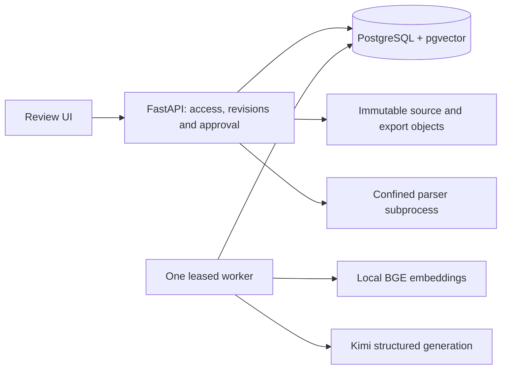

# AssureDesk

Permission-aware security questionnaire review with **bounded, self-correcting RAG** and human approval.

AssureDesk turns a supported XLSX questionnaire into reviewed, cited answers. It retrieves evidence the user can read **and the customer is allowed to receive**, searches again for missing facts, and exports only current approved revisions. Atlas, Acme and Nova are fictional; all included evaluation and demonstration data is synthetic.

[Implementation manual](MANUAL.md) · [Locked evaluation](output/evaluation/kimi-k3-locked-report.md) · [Verification manifest](output/kimi-release-manifest.json) · [Scripted demo](output/playwright/assuredesk-three-minute-demo.webm)

## What it does

- Separates document readability from customer disclosure authority.
- Combines BM25 and dense retrieval, with targeted correction for identified gaps.
- Shows original excerpts, requirement coverage, citations and revision history.
- Requires a security reviewer to approve the exact answer revision, including Unknown responses.
- Invalidates approvals after relevant content, scope or policy changes; rechecks exports on download.
- Persists job leases, stage results, attempt counters and conservative cost reservations across interruptions.

## Architecture



**Answer pipeline:** import → confirm mapping → retrieve → assess requirements → correct missing evidence → check support → human review → approve → export.

The stack is Python 3.12, FastAPI/Jinja with vanilla JavaScript, PostgreSQL 17/pgvector, LangGraph, local BGE embeddings and Kimi generation. One application image serves the API and worker. No separate vector service, broker, multi-agent runtime, OCR or enterprise SSO is required by this pilot.

Permissions are resolved before lexical/vector retrieval and checked again at evidence access, model dispatch, draft publication, approval, export and download. Model support checks assist review; they never grant disclosure authority.

## Measured results

Recorded on **5 October 2026**: 30 fresh locked questions × three variants, with all 90 outcomes retained and source-grounded judgments. There were 13 reference-answerable questions and 17 requiring clarification, conflict handling or abstention.

| Metric | Dense | Hybrid | Corrective | Range on this benchmark; ideal |
|---|---|---|---|---|
| Complete supported answers | 6/13 (46.2%) | 10/13 (76.9%) | **12/13 (92.3%)** | 0–100%; **100%** |
| Final candidate Recall@6 | 84.6% | 88.5% | **96.2%** | 0–100%; **100%** |
| Final candidate Precision@6 | 28.2% | 29.5% | 32.1% | 0–33.3%; **33.3%** |
| Final candidate nDCG@6 | 0.858 | 0.895 | 0.955 | 0–1; **1** |
| Correct non-answerable routing | 16/17 | 16/17 | **17/17** | 0–100%; **100%** |
| Citation entailment | 14/15 | 20/20 | 25/25 | 0–100%; **100%** |
| Citation coverage | 15/18 | 20/22 | 25/27 | 0–100%; **100%** |
| Processing latency p50 / p95 | 24.1 / 41.8 s | 22.3 / 40.5 s | 39.6 / 63.5 s | ≥0 s; lower is better, no universal maximum |
| Known cost estimate + unknown reservation | $0.429555 | $0.475764 | $0.653589 | ≥$0; lower is better, no universal maximum |

Corrective Precision@6 is **32.1% / 33.3% possible on this benchmark**: 25 relevant hits across 78 result positions, versus an ideal 26/78. Precision@6 generally ranges from 0–100%; this corpus has only two relevant reference chunks per answerable question, so its achievable ceiling is `2/6 = 33.3%`. It is not answer accuracy. Fractional counts in the table retain their observed denominators; an ideal rate is 100%. Correction recovered two of three hybrid misses, with no observed regressions among ten hybrid successes.

The remaining corrective miss omitted a qualification despite a positive model self-check. Some complete answers also needed citation repairs. Corrective RAG met the 90% factual point target with 12/13 complete supported answers. This small synthetic benchmark does not establish production reliability.

[Full metrics](output/evaluation/kimi-k3-locked-report.json) include denominators, retrieval/context stages, routing, citations, uncertainty and costs. [Historical reports and frozen artifacts](output/evaluation/) preserve earlier failures rather than replacing them with successful reruns.

## Quick start with Docker

Requires Docker Compose. From this repository, create the ignored local configuration **only if it does not already exist**:

```sh
test -f .env || cp .env.example .env
```

Set `MOONSHOT_API_KEY` privately in `.env`. Do not commit it. The worker receives the credential; the API container does not.

```sh
docker compose build
docker compose up -d db
docker compose run --rm api alembic upgrade head
docker compose run --rm api python -m app.cli checkpoints
docker compose run --rm api python -m app.cli prepare-model
docker compose run --rm api python -m app.cli seed
docker compose run --rm api python -m app.cli check-parser
docker compose up -d api worker
```

Open **http://127.0.0.1:8012**. Synthetic demo credentials are generated once in `/app/data/demo-credentials.json` inside the application volume; read them locally without posting or committing them. `sales` is assigned to Acme, `reviewer` to Acme/Nova, and `admin` manages access without content approval authority. Setup does not call the generation provider; model preparation downloads embeddings.

For native development, install Python 3.12 and PostgreSQL 17 with pgvector, configure `DATABASE_URL`, run `uv sync --frozen`, then use the same migration/CLI steps with `uv run`. Start the processes in separate terminals:

```sh
MOONSHOT_API_KEY='' uv run uvicorn app.web:create_app --factory --host 127.0.0.1 --port 8012 --no-access-log
uv run python -m app.worker
```

The Compose configuration is for loopback development. Private hosting needs TLS, deployment-specific credentials and persistent recovery arrangements.

## Input profile and safeguards

Questionnaires must have one visible sheet, four mapped ID/question/answer/explanation columns and at most 50 questions. The answer enum includes Yes, No, Partial, Not applicable, Unknown and Declined. Unsupported active or hidden workbook content is rejected; export constructs a clean file with literal text values.

Evidence accepts supported text PDFs, UTF-8 Markdown and curated statement JSON. Scans, suspicious PDF tables/columns and unreliable extraction are rejected for curation. Parsing runs in a restricted subprocess: Linux requires Landlock/seccomp; macOS uses the OS sandbox and a memory watchdog.

Runs allow up to three retrieval rounds, five query embeddings, seven generation attempts including one shared format repair, and 90 seconds of active work. Spending caps remain **$0.15/run, $5/workbook, $5/UTC day, $15/evaluation batch and $30/campaign**. Failed or uncertain calls retain conservative reservations. Daily/TPD provider limits stop dispatch until reset; there is no hidden retry or automatic cap increase.

## Verification and reproduction

The frozen implementation passed 104 tests on macOS and 104 on Linux, with two optional browser cases skipped. Later code-review fixes passed 41 affected tests, one PostgreSQL regression and one real-browser workflow, plus lint/format checks. They fixed missing-run retrieval denominators, rebuild activation IDs and newest-run ordering. Current source includes those later fixes; the frozen generation archive remains separate.

```sh
uv sync --frozen
uv run ruff check .
uv run ruff format --check .
uv run pytest -q
```

PostgreSQL and browser checks require their explicit test environments. Deterministic tests use injected providers and make no paid generation calls. CI runs tests, migrations, secret scanning and container checks without provider keys; no successful hosted CI run is claimed.

To reproduce saved scores without credentials or a database, extract [the Kimi evaluation artifacts](output/evaluation/kimi-evaluation-artifacts.zip) into a fresh directory:

```sh
uv run python -m app.evaluation report --root EXTRACTED_DIRECTORY --batch kimi-validation-k3-v2
uv run python -m app.evaluation report --root EXTRACTED_DIRECTORY --batch kimi-locked-v1
```

Offline rescoring after the review fixes confirmed unchanged numerical metrics for both completed batches. Outcomes, labels and unknown charges remain preserved.

[Review screenshot](output/playwright/inspectable-answer.png) and [three-minute demo](output/playwright/assuredesk-three-minute-demo.webm) use synthetic fixtures. The video has deterministic provider responses; it demonstrates workflow behavior, not live-model accuracy.

## Repository and documentation

| Path | Purpose |
|---|---|
| `app/` | Policy, parsing, retrieval, graph, business services, API and UI |
| `tests/` | Deterministic boundary, API, parser, PostgreSQL and browser checks |
| `migrations/` | Application schema migrations |
| `MANUAL.md` | Architecture, code explanations, design alternatives, operations and 60 interview Q&As |
| `output/evaluation/` | Reviewed reports, failures and frozen reproducibility archives |
| `.github/workflows/verify.yml` | Credential-free CI verification |

Local `.env`, runtime data/models, backup keys, caches, logs and random browser recordings are excluded from Git. Only reviewed reports and named demo artifacts are included. Other portfolio projects and planning directories are outside this repository.

The manual explains the adaptation of the Production RAG course's retrieval, hybrid search, parent context and persisted review ideas. Maintained LangGraph/text-splitter libraries are used directly; no tutorial source, prompts, credentials or assets were transplanted under uncertain license evidence. See [the adaptation and tradeoff discussion](MANUAL.md#20-tutorial-adaptation-and-engineering-tradeoffs).

## Current scope

This is a **restricted local pilot**. A configured scheduled off-host backup remains outstanding. Encrypted snapshot/restore tooling and a local restore drill are implemented; an actual off-host schedule is not claimed. Model self-checks, synthetic test results and healthy services do not substitute for customer approval or production acceptance.
